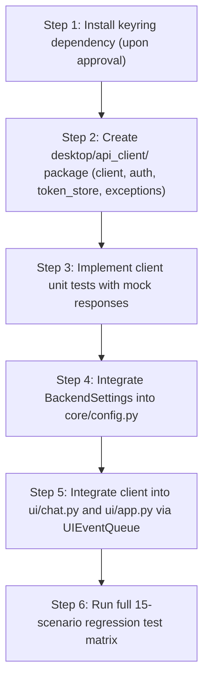

# OLIVER 3.0 — Phase 2A Final Read-Only Integration Review & Implementation Readiness Audit

**Document:** `docs/OLIVER_3_PHASE_2A_FINAL_REVIEW.md`  
**Date:** 2026-11-07  
**Author:** Senior Python Desktop Architect, FastAPI Integration Engineer, and Database Safety Reviewer  
**Status:** Audit Completed  
**Final Readiness Verdict:** **`READY AFTER REQUIRED CORRECTIONS`**  
**Execution Boundary:** Strictly read-only audit. No source code modified, no packages installed, no databases altered, no containers started, and no Git commits created.

---

## 1. Executive Summary & Review Verdict

A comprehensive architectural inspection and readiness audit of the **OLIVER 3.0 Phase 2A Desktop-Backend Integration Plan** (`docs/OLIVER_3_PHASE_2A_PLAN.md`) was conducted against the live desktop application (`main.py`, `ui/`, `core/`, `ai/`) and the central FastAPI backend codebase (`backend/`).

### Final Decision: **`READY AFTER REQUIRED CORRECTIONS`**

The proposed Phase 2A architecture is conceptually sound, adheres to modularity standards, preserves the existing CustomTkinter HUD layout and local skills, and leverages the proven `UIEventQueue` bridge to ensure zero UI thread blocking.

However, implementation cannot proceed until four specific integration and safety corrections are formally incorporated:
1. **Ambiguous Network Timeout Double-Execution Hazard:** The current plan fails to distinguish between immediate connection failure (`httpx.ConnectError`) and in-flight read timeouts (`httpx.ReadTimeout`). Blind local fallback on read timeout will cause duplicate Ollama inferences and state divergence between client and server.
2. **Missing Backend Chat Idempotency:** The backend `POST /api/chat` endpoint does not currently accept a `client_message_id` or `idempotency_key`. The client must have a safe retry and verification strategy.
3. **Concurrent Refresh Token Race Hazard:** The backend implements strict token reuse detection that revokes **all** user sessions if an already-revoked refresh token is re-submitted. The desktop client must enforce a strict re-entrant thread mutex around token refresh.
4. **Unapproved External Dependency:** The proposed `token_store.py` module depends on `keyring>=24.0.0` (which is confirmed **not installed** in the workstation Python environment). User approval is required before installing packages.

---

## 2. Inspected Files & Architecture Alignment

The following files were inspected in the live workspace:

### Backend Subsystem (`backend/`):
- `backend/app/routers/auth.py`: Public authentication endpoints (`/register`, `/login`, `/refresh`, `/logout`).
- `backend/app/routers/chat.py`: Authenticated chat routing (`/chat`, `/conversations`, `/conversations/{id}/messages`).
- `backend/app/schemas/auth.py`: Pydantic validation models for authentication payloads.
- `backend/app/schemas/chat.py`: Request/response schemas for messaging and conversations.
- `backend/app/services/auth_service.py`: JWT signing, Argon2/bcrypt hashing, refresh token rotation, and reuse detection.
- `backend/app/services/chat_service.py`: User-isolated message persistence and Ollama provider dispatch.
- `backend/app/core/security.py`: Cryptographic helpers and token hashing (`hash_token`).
- `backend/app/core/config.py`: Pydantic settings and token expiration windows.

### Desktop Subsystem:
- [main.py](file:///c:/Users/ASHISH/OneDrive/Desktop/Documents/my own voice assistant/main.py): Application entry point, environment loading, and `OliverApp` initialization.
- [ui/app.py](file:///c:/Users/ASHISH/OneDrive/Desktop/Documents/my own voice assistant/ui/app.py): CustomTkinter window lifecycle, 3-column cockpit HUD layout, status indicators, and modal presentation.
- [ui/chat.py](file:///c:/Users/ASHISH/OneDrive/Desktop/Documents/my own voice assistant/ui/chat.py): `CommandConsolePanel`, command dispatch loop, streaming speech integration, and `_run_assistant_command`.
- [ui/event_bridge.py](file:///c:/Users/ASHISH/OneDrive/Desktop/Documents/my own voice assistant/ui/event_bridge.py): Thread-safe `UIEventQueue` with bounded polling (`after(25)`) and queue management.
- [ai/assistant.py](file:///c:/Users/ASHISH/OneDrive/Desktop/Documents/my own voice assistant/ai/assistant.py): Intent classification, dangerous command interception, and dispatch logic.
- [ai/ai_service.py](file:///c:/Users/ASHISH/OneDrive/Desktop/Documents/my own voice assistant/ai/ai_service.py): Local workstation Ollama interface with token streaming.
- [core/config.py](file:///c:/Users/ASHISH/OneDrive/Desktop/Documents/my own voice assistant/core/config.py): Typed application configuration (`OliverConfig`).
- [security/kill_switch.py](file:///c:/Users/ASHISH/OneDrive/Desktop/Documents/my own voice assistant/security/kill_switch.py): Global emergency abort mechanism.

---

## 3. Actual Backend API Contracts vs. Desktop Expectations

| Endpoint | Method | Request Schema | Response Schema | Auth Required | Status Codes & Errors |
|---|---|---|---|---|---|
| `/api/auth/login` | `POST` | `LoginRequest(email: str, password: str)` | `TokenResponse(access_token: str, refresh_token: str, token_type: "bearer", expires_in: int)` | None (Public) | **200 OK**<br>**401 Unauthorized** (`"Incorrect email or password."`)<br>**403 Forbidden** (`"This user account is inactive."`)<br>**422 Unprocessable** (regex email mismatch)<br>**429 Too Many Requests** (auth rate limit) |
| `/api/auth/refresh` | `POST` | `RefreshTokenRequest(refresh_token: str)` | `TokenResponse(access_token: str, refresh_token: str, token_type: "bearer", expires_in: int)` | None (Token in body) | **200 OK**<br>**401 Unauthorized** (`"Invalid refresh token."`, `"Refresh token reuse detected. Session terminated for security."`, `"Refresh token expired. Please log in again."`)<br>**401 Unauthorized** (inactive user account) |
| `/api/auth/logout` | `POST` | `LogoutRequest(refresh_token: str)` | `{"message": "Logged out successfully."}` | None (Token in body) | **200 OK** (marks `revoked=True` in DB) |
| `/api/chat` | `POST` | `ChatRequest(message: str, conversation_id: Optional[str] = None)` | `ChatResponse(conversation_id: str, reply: str, latency_ms: float, model: str)` | **Bearer JWT** | **200 OK**<br>**401 Unauthorized** (missing, invalid, or expired JWT)<br>**404 Not Found** (`"Conversation not found or access denied."`)<br>**429 Too Many Requests** (chat rate limit 30/min)<br>**500 / 502 / 504** (Ollama offline or execution failure) |
| `/api/conversations` | `GET` | None | `List[ConversationResponse(id: str, title: str, created_at: datetime, updated_at: datetime)]` | **Bearer JWT** | **200 OK**<br>**401 Unauthorized** |
| `/api/conversations/{id}/messages` | `GET` | None | `ConversationDetailResponse(id: str, title: str, created_at: datetime, updated_at: datetime, messages: List[MessageResponse])` | **Bearer JWT** | **200 OK**<br>**401 Unauthorized**<br>**404 Not Found** |
| `/api/health` | `GET` | None | `{"status": "healthy", ...}` | None (Public) | **200 OK** |

---

## 4. Desktop Integration Compatibility & Critical Gaps

### 4.1 Missing Idempotency Key in Chat Contract
- **Inspected Fact:** In `backend/app/services/chat_service.py`, `process_chat()` commits the incoming user message to the database **before** awaiting `ai_provider.generate_response()`.
- **The Problem:** If a network interruption occurs while the backend Ollama is generating a response (or if the client times out), the user message has already been written to the database. If the client retries the request, the backend will treat it as a second user message and generate a duplicate assistant reply.
- **Correction Required:** The desktop client must **not** automatically retry `POST /api/chat` without verifying whether the previous request was recorded. In future backend iterations, `ChatRequest` should include an optional `client_message_id` for deduplication.

### 4.2 Streaming vs. Non-Streaming Response Contract
- **Inspected Fact:** The desktop UI (`ui/chat.py` lines 485–500) uses token streaming via `AIService.ask_stream()` to deliver real-time visual typing and sentence-level TTS speech. Backend `POST /api/chat` is currently synchronous/non-streaming, returning the full response once generation completes.
- **Architectural Resolution:** For Phase 2A, the desktop client will accept the complete response payload and dispatch it to `UIEventQueue` as a single finished entry. Sentence-level speech will be played in full upon arrival. Streaming via SSE or WebSocket is reserved for Phase 3.

### 4.3 Active Conversation Tracking
- **Inspected Fact:** `ChatRequest` accepts an optional `conversation_id`. If `None`, `ChatService` auto-creates a new conversation.
- **Desktop Requirement:** `OLIVERBackendClient` or the desktop chat controller must track `active_conversation_id` in memory across user turns so that follow-up questions remain in the same conversation thread.

---

## 5. Authentication & Token Storage Security Analysis

### 5.1 Token Storage Security
- **Platform:** Windows 10/11.
- **Mechanism:** Proposed `token_store.py` utilizes `keyring` backed by `keyring.backends.Windows.WinVaultKeyring` (Windows Credential Manager).
- **Cryptographic Boundary:** Keys stored in Windows Credential Manager are encrypted at rest using Windows DPAPI (Data Protection API), tied to the logged-in Windows user account.
- **Safety Rule:** Refresh tokens are **never** persisted in `.env`, config JSON files, or SQLite databases. Access tokens are held **strictly in-memory** and expire after 15 minutes.

### 5.2 Token Refresh Concurrency & Reuse Detection Hazard
- **Inspected Fact:** In `backend/app/services/auth_service.py` (lines 108–115):
  ```python
  if db_token.revoked:
      # Token reuse detected! Revoke all tokens for this user for security
      db.query(RefreshToken).filter(RefreshToken.user_id == db_token.user_id).update({"revoked": True})
      db.commit()
      raise HTTPException(status_code=401, detail="Refresh token reuse detected...")
  ```
- **The Threat:** If two desktop background threads make concurrent requests with an expired access token, both will receive 401. If both simultaneously attempt to call `POST /api/auth/refresh` using the same refresh token, the second call will hit the rotated (revoked) token, trigger reuse detection, and **revoke all sessions for the user**.
- **Correction Required:** `AuthManager` must implement a re-entrant mutex (`threading.RLock`) around the refresh procedure. When a 401 is encountered:
  1. Acquire lock.
  2. Check if another thread has already refreshed the access token while waiting for the lock. If so, retry request with the new access token immediately.
  3. If still expired, perform `POST /api/auth/refresh`, update memory and keyring, and release lock.

### 5.3 Secret Redaction & Logging
- Ensure `httpx` HTTP request logging does not log raw `Authorization: Bearer ...` headers or `password` fields.
- Mask sensitive tokens in error logs and debug dumps.

---

## 6. Offline Fallback & Network Timeout Analysis

### 6.1 The Ambiguous Timeout Hazard
A critical flaw in standard offline fallback designs is treating all HTTP exceptions identically:
```python
# DANGEROUS PATTERN (DO NOT USE):
try:
    return client.chat(message)
except Exception:
    return local_ai.ask(message) # CAUSES DUPLICATE EXECUTION ON TIMEOUT!
```

### 6.2 Strict Failure Classification Matrix
The desktop client must categorize network failures into three distinct tiers:

| Error Type | Exception | Cause | Safe Action |
|---|---|---|---|
| **Tier 1: Immediate Connection Failure** | `httpx.ConnectError`, `httpx.ConnectTimeout` | Backend process not running or port unreachable. Request was **never delivered** to server. | **Safe to fallback immediately** to local `AIService.ask()`. Update indicator to `[ BACKEND OFFLINE - LOCAL FALLBACK ]`. |
| **Tier 2: In-Flight Read Timeout** | `httpx.ReadTimeout`, `httpx.WriteTimeout` | Request was received by backend; Ollama is taking longer than client timeout (e.g., 20s). | **DO NOT blindly fall back locally.** Doing so causes the local Ollama to run concurrently with the backend Ollama, creating duplicate responses and divergent chat history. Display: *"Backend is processing request, but took longer than expected. Please wait or check status."* |
| **Tier 3: HTTP Protocol / Auth Errors** | `httpx.HTTPStatusError` (401, 403, 404, 429) | Authentication expired, invalid conversation, or rate limit exceeded. | **DO NOT fallback to local.** Handle specifically: 401 triggers refresh, 429 informs user of rate limit, 403 notifies account status. |

---

## 7. UI-Thread Safety & Event Bridge Validation

### 7.1 CustomTkinter Main-Thread Rules
In Tkinter and CustomTkinter, calling widget methods (`.configure()`, `.insert()`, `.delete()`, `.pack()`) from background threads causes memory corruption, silent crashes, or visual race conditions.

### 7.2 Validation of Existing `UIEventQueue`
- Inspected file: [ui/event_bridge.py](file:///c:/Users/ASHISH/OneDrive/Desktop/Documents/my own voice assistant/ui/event_bridge.py).
- Findings:
  - Queue operations are fully thread-safe (`queue.Queue` + re-entrant locks).
  - Main thread drains events in batches of up to 50 every 25ms via `.after(25, self._poll)`.
  - Clean shutdown semantics and discarded-event tracking.
- **Architectural Requirement:** The proposed `OLIVERBackendClient` worker threads must **never** touch GUI widgets directly. All UI updates, status indicator changes, and console log entries must be posted strictly via:
  ```python
  self.event_bridge.post(self._display_chat_response, reply, status)
  ```

---

## 8. Database & Git Safety Audit

### 8.1 SQLite Database Protection
- Existing desktop database: `database/oliver.db` contains user notes, reminders, task states, and legacy chat sessions.
- **Status:** **UNTOUCHED AND UNMODIFIED**.
- **Sidecar Files:** `database/oliver.db-wal` and `database/oliver.db-shm` are transient SQLite write-ahead logging files. In this turn, when SQLite closed connections, the OS/SQLite cleanly removed the temporary sidecars. Both patterns are documented for Git ignore exclusion.
- **Backend Database:** `backend/oliver_dev.db` is completely separate from `database/oliver.db`. Zero cross-database coupling exists.

### 8.2 Working Tree Inspection
`git status --short` confirms:
- Zero application code files were created or modified.
- Zero migrations were run.
- Zero commits or branch switches were executed.

---

## 9. Required Test-Readiness Matrix (15 Scenarios)

Before Phase 2A implementation can be considered complete, the following 15 test scenarios must be executed and verified:

| Test # | Category | Scenario Description | Expected Assertion | Status |
|---|---|---|---|---|
| **T01** | Configuration | `BACKEND_MODE="local"` default | System boots in local mode; zero HTTP requests initiated. | **Ready for Test** |
| **T02** | Configuration | `BACKEND_MODE="backend"` configuration | System enables backend client routing on startup. | **Ready for Test** |
| **T03** | Authentication | Valid login submission | Returns JWT and refresh token; refresh token saved to Windows Credential Manager. | **Ready for Test** |
| **T04** | Authentication | Invalid password submission | Returns 401; UI shows error dialog; zero tokens stored. | **Ready for Test** |
| **T05** | Authentication | Inactive account login | Returns 403; UI shows account disabled notice. | **Ready for Test** |
| **T06** | Chat Flow | Successful backend chat dispatch | Sends prompt to `/api/chat`; response rendered via `UIEventQueue`. | **Ready for Test** |
| **T07** | Offline Fallback | Backend connection refused (`ConnectError`) | Immediate fallback to local `AIService.ask()`; HUD indicator turns amber. | **Ready for Test** |
| **T08** | Offline Fallback | Backend read timeout (`ReadTimeout`) | Does NOT trigger local Ollama duplicate; UI displays timeout warning. | **Ready for Test** |
| **T09** | Token Lifecycle | Transparent access token refresh | Expired JWT refreshed seamlessly via `/api/auth/refresh`; chat completes. | **Ready for Test** |
| **T10** | Token Lifecycle | Concurrent refresh race prevention | Multiple threads refreshing simultaneously acquire lock; zero reuse detection triggers. | **Ready for Test** |
| **T11** | Token Lifecycle | Revoked refresh token handling | Client clears credentials, transitions HUD to `[ LOCAL ]`, prompts re-login. | **Ready for Test** |
| **T12** | Logout | Explicit logout action | Calls `/api/auth/logout`, purges memory tokens, deletes Windows Credential Manager entry. | **Ready for Test** |
| **T13** | UI Thread Safety | Simulated network latency (5s delay) | CustomTkinter GUI remains fully responsive; orb animation spins smoothly. | **Ready for Test** |
| **T14** | Subsystem Parity | Local skills execution | Browser search, notes, reminders, and voice continue running locally with zero regression. | **Ready for Test** |
| **T15** | Security | Log redaction verification | Tokens and passwords never appear in console stdout or debug log files. | **Ready for Test** |

---

## 10. Identified Blockers & Required Pre-Implementation Corrections

| # | Item | Classification | Action Required Before Implementation |
|---|---|---|---|
| **B1** | `keyring` Package Missing | Dependency Blocker | Obtain user approval to install `keyring>=24.0.0` in the workstation environment. |
| **B2** | Network Timeout Classification | Architectural Gap | Update client error handling to separate `ConnectError` (local fallback) from `ReadTimeout` (pending/retry alert). |
| **B3** | Concurrent Refresh Lock | Concurrency Hazard | Specify explicit `threading.RLock` in `AuthManager` to prevent refresh token reuse revocation. |
| **B4** | Conversation Thread Persistence | Functional Requirement | Ensure `active_conversation_id` is maintained in client state across turns. |

---

## 11. Recommended Implementation Sequence (Upon Approval)

Once explicit authorization to begin Phase 2A implementation is granted:



---

## 12. Final Decision & Sign-off

### Final Verdict: **`READY AFTER REQUIRED CORRECTIONS`**

**Reasoning:**  
The architectural foundation and integration plan are robust, non-invasive, and well-aligned with the OLIVER 3.0 vision. Implementation should proceed immediately once the four required corrections (dependency approval, timeout classification, concurrency locking, and conversation tracking) are confirmed by the user.

**STOPPED. Audit report complete. Awaiting user review and authorization before proceeding.**

