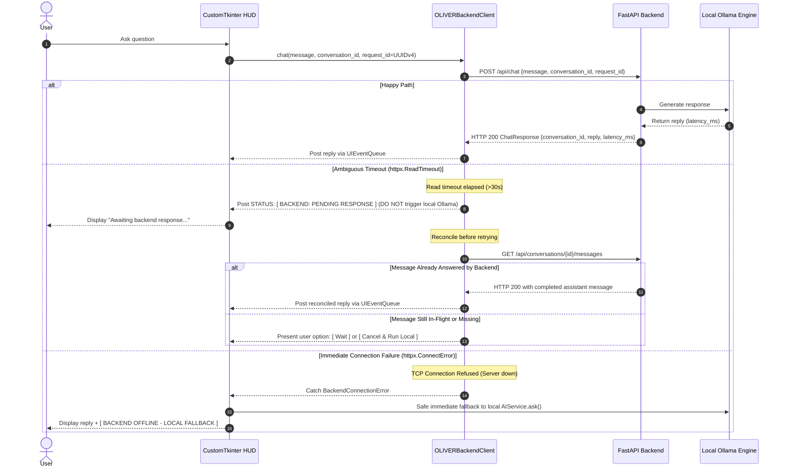

# OLIVER 3.0 — Master Plan: Phase 2A Desktop Client Integration

**Document:** `docs/OLIVER_3_PHASE_2A_PLAN.md`  
**Status:** Approved for Planning and Documentation Only  
**Strict Policy:** No code changes, no dependency installations, and no UI modifications until explicit authorization.

---

## 1. Existing Architecture Findings (Inspected Facts)

A thorough read-only inspection of the existing Windows desktop codebase and central backend reveals the following verified facts:

| Component | File / Location | Inspected Implementation Facts |
|---|---|---|
| **Entry Point** | [main.py](file:///c:/Users/ASHISH/OneDrive/Desktop/Documents/my own voice assistant/main.py) | Calls `load_environment()` (`.env`), `validate_environment()`, and instantiates `OliverApp()` from `ui/app.py`. |
| **Desktop Shell** | [ui/app.py](file:///c:/Users/ASHISH/OneDrive/Desktop/Documents/my own voice assistant/ui/app.py) | Instantiates `OliverApp(ctk.CTk)`, sets dark theme, builds 3-column cockpit layout, initializes `AshishAssistant`, `UIEventQueue`, and `CommandConsolePanel`. |
| **Central Config** | [core/config.py](file:///c:/Users/ASHISH/OneDrive/Desktop/Documents/my own voice assistant/core/config.py) | `OliverConfig` loads typed Pydantic models (`LLMSettings`, `VoiceSettings`, `SecuritySettings`, `AgentSettings`, `BrowserSettings`) from `.env`. Singleton accessible via `get_config()`. |
| **Console & Chat Flow** | [ui/chat.py](file:///c:/Users/ASHISH/OneDrive/Desktop/Documents/my own voice assistant/ui/chat.py) | `CommandConsolePanel` processes input via `_run_assistant_command(command, request_id)`. General Q&A calls `self.assistant.ai_service.ask_stream()`; commands call `self.assistant.handle_result(command)` (or fallback `self.assistant.handle(command)`). |
| **Assistant Routing** | [ai/assistant.py](file:///c:/Users/ASHISH/OneDrive/Desktop/Documents/my own voice assistant/ai/assistant.py) | `AshishAssistant.handle()` determines intent, checks danger via `is_dangerous_command()`, dispatches local commands (`_handle_commands`), memory commands (`_handle_memory_commands`), and falls back to `self.ai_service.ask(text, request_id=request_id)`. |
| **Local AI Service** | [ai/ai_service.py](file:///c:/Users/ASHISH/OneDrive/Desktop/Documents/my own voice assistant/ai/ai_service.py) | `AIService` directly contacts local Ollama (`http://localhost:11434`) using `requests`. Features health check cache, warmup thread, and streaming token delivery (`ask_stream`). |
| **UI Threading Model** | [ui/event_bridge.py](file:///c:/Users/ASHISH/OneDrive/Desktop/Documents/my own voice assistant/ui/event_bridge.py) | `UIEventQueue` provides a thread-safe queue bridge. Background threads post tasks via `event_bridge.post(callable, *args, **kwargs)`, and the main CustomTkinter GUI thread polls and executes them every 25ms (`after(25)`). Zero direct widget access from background threads. |
| **Backend Auth APIs** | [backend/app/routers/auth.py](file:///c:/Users/ASHISH/OneDrive/Desktop/Documents/my own voice assistant/backend/app/routers/auth.py) | `POST /api/auth/login` returns access token (15-min) and refresh token (7-day). `POST /api/auth/refresh` rotates tokens. `POST /api/auth/logout` revokes tokens. Strict reuse detection revokes all sessions on reused old tokens. |
| **Backend Chat API** | [backend/app/routers/chat.py](file:///c:/Users/ASHISH/OneDrive/Desktop/Documents/my own voice assistant/backend/app/routers/chat.py) | `POST /api/chat` requires Bearer token, accepts `ChatRequest(message, conversation_id)`. **Audit finding:** Missing client-generated idempotency key/request ID, causing vulnerability to duplicate processing during network timeouts. |
| **Testing Conventions** | `tests/regression/` & `backend/tests/` | Standard `unittest` for desktop app, `pytest` for backend (14/14 tests verified passing). Mocks used for external boundaries. |

---

## 2. Proposed API Client Architecture (`desktop/api_client/`)

A modular, self-contained client package placed in `desktop/api_client/`:

```text
desktop/api_client/
├── __init__.py
├── client.py          # Central OLIVERBackendClient (HTTPX session, timeout, error handling, idempotency)
├── auth.py            # Authentication, login/logout, and re-entrant locked token refresh logic
├── token_store.py     # Secure token storage via Windows Credential Manager (keyring / DPAPI)
└── exceptions.py      # Typed client exceptions (BackendOfflineError, AmbiguousTimeoutError, AuthError)
```

### Module Responsibilities:
1. **`client.py` (`OLIVERBackendClient`)**:
   - Manages an internal `httpx.Client(timeout=httpx.Timeout(connect=5.0, read=30.0, write=5.0, pool=5.0))` connection pool.
   - Methods:
     - `check_health() -> tuple[bool, dict]`: Checks `GET /api/health`.
     - `chat(message: str, conversation_id: Optional[str] = None, request_id: Optional[str] = None) -> ChatResponse`:
       - Attaches client-generated `request_id` (UUIDv4) in payload and `X-Request-ID` header.
       - Attaches `Authorization: Bearer <access_token>` from `auth.py`.
       - Catches HTTP 401, invokes thread-safe token refresh via `auth.py`, and retries request once.
     - `reconcile_conversation(conversation_id: str, request_id: str) -> Optional[MessageResponse]`:
       - Fetches `GET /api/conversations/{id}/messages` to verify whether an ambiguous timeout request was successfully committed and answered by the backend.
2. **`auth.py` (`AuthManager`)**:
   - Keeps short-lived `access_token` in memory only.
   - Implements a re-entrant mutex (`threading.RLock`) around the token refresh procedure. When multiple concurrent worker threads encounter a 401, only the first thread executes `POST /api/auth/refresh`. Subsequent threads await the lock and then reuse the fresh access token, preventing backend token reuse detection lockouts.
   - If refresh token is revoked or expired, purges memory and notifies user to re-authenticate.
3. **`token_store.py` (`WindowsCredentialStore`)**:
   - Interfaces with Windows Credential Manager using `keyring` (DPAPI-backed `WinVaultKeyring`).
   - Service Name: `OLIVER_AI_ASSISTANT`.
   - Key: User email.
   - Value: Rotating `refresh_token` string.
   - **Security Guarantee:** Refresh token is never written to plaintext `.env`, config JSON, or SQLite database.
4. **`exceptions.py`**:
   - `BackendConnectionError`: Network failure or backend server offline (`ConnectError`, `ConnectTimeout`). Request never reached server.
   - `AmbiguousTimeoutError`: Request sent and in-flight, but read timeout elapsed (`ReadTimeout`). Server may still be processing.
   - `AuthenticationError`: Invalid password or revoked session.
   - `BackendRateLimitError`: HTTP 429 received from backend.

---

## 3. Backend Chat Idempotency & Duplicate-Execution Prevention Design

### 3.1 The Ambiguous Network Timeout Hazard
In distributed desktop-backend architectures, treating network errors generically causes duplicate execution:
1. Desktop submits `POST /api/chat`.
2. Backend receives request, saves user message to database, and begins local Ollama inference (taking 4–20s).
3. Desktop client encounters `ReadTimeout` (e.g. at 15s) and aborts its socket.
4. If desktop immediately falls back to local Ollama, the user's laptop runs inference locally while the backend also finishes inference and commits the assistant message.
5. **Result:** Severe duplicate computation, divergent conversation histories, and out-of-order responses.

### 3.2 Two-Level Idempotency Solution



### 3.3 Backend Contract Enhancement (Phase 2A Scope)
To ensure complete end-to-end idempotency, `backend/app/schemas/chat.py` and `backend/app/services/chat_service.py` will support the client-generated `request_id`:

1. **Schema Update (`backend/app/schemas/chat.py`)**:
   ```python
   class ChatRequest(BaseModel):
       message: str = Field(min_length=1, description="User prompt or command")
       conversation_id: Optional[str] = Field(default=None, description="Existing conversation ID or None for auto-create")
       request_id: Optional[str] = Field(default=None, description="Client-generated idempotency UUIDv4")
   ```

2. **Deduplication Logic (`backend/app/services/chat_service.py`)**:
   - If `req.request_id` is supplied, check whether a message with this `request_id` (or user message with identical content submitted within the last 60 seconds in this conversation) has already been processed or is currently generating.
   - If an assistant reply already exists for this `request_id`, return the existing `ChatResponse` immediately without re-triggering Ollama inference.
   - If Ollama generation is currently in flight for this `request_id`, return HTTP 202 Accepted or await completion rather than launching a second concurrent Ollama inference job.

---

## 4. Feature Flag Behavior (`BACKEND_MODE`)

### Configuration Setting in `core/config.py`:
```python
class BackendSettings(BaseModel):
    backend_mode: str = Field(default="local", description="'local' or 'backend'")
    backend_url: str = Field(default="http://127.0.0.1:8000")
    auto_fallback_local: bool = Field(default=True)
    request_timeout_seconds: float = Field(default=30.0)
```
- **Default Value:** Strictly `"local"`.
- **Allowed Values:** `"local"` | `"backend"`.

### Operational Semantics:
1. **`BACKEND_MODE = "local"` (Default)**:
   - 100% existing OLIVER 2.0 behavior.
   - All AI calls route directly to workstation Ollama via `AIService`.
   - Zero network calls made to FastAPI backend.
   - Status Indicator: `[ LOCAL ]` (cyan/grey).
2. **`BACKEND_MODE = "backend"`**:
   - General AI Q&A requests route to `POST /api/chat` via `desktop/api_client/`.
   - Synchronized conversation history saved to central backend database.
   - **Local Execution Preserved:** System commands, browser automation, notes, reminders, task monitor, and emergency stop continue executing locally on Windows.
3. **Triaged Failure Handling**:
   - **On `httpx.ConnectError`:** Immediate local fallback to `AIService.ask()`. Indicator updates to `[ BACKEND OFFLINE - LOCAL FALLBACK ]` (amber).
   - **On `httpx.ReadTimeout`:** No blind local fallback. Client transitions indicator to `[ BACKEND: PENDING RESPONSE ]` and executes reconciliation.
   - **On `httpx.HTTPStatusError` (401, 403, 429):** Appropriate authentication or rate-limit notice displayed; zero local AI fallback.

---

## 5. Existing UI Integration Points

### Non-Invasive UI Design Principles:
- **No Visual Overhaul**: The existing 3-column cockpit HUD layout, glowing canvas orb, and command console remain visually identical.
- **Connection Indicator Pill**:
  - Located on the left status panel below system indicators (`OLLAMA`, `VOICE`, `KILL SWITCH`).
  - States:
    - `[ LOCAL ]` (Dim Cyan): Purely local OLIVER 2.0.
    - `[ BACKEND: ONLINE ]` (Bright Green): Authenticated and connected to FastAPI backend.
    - `[ BACKEND: OFFLINE ]` (Amber): Backend mode configured, but connection refused (local fallback active).
    - `[ BACKEND: PENDING ]` (Pulse Blue): Request in flight / awaiting backend generation.
- **Minimal Login Modal (`BackendLoginModal`)**:
  - Modeled after the existing `ConfirmationModal` in `ui/app.py`.
  - Fields: Email, Password.
  - Buttons: `[ CONNECT ]`, `[ CANCEL ]`.

---

## 6. Threading & Background Networking Architecture

### Zero UI Thread Blocking:
- Tkinter / CustomTkinter requires that all GUI modifications occur strictly on the main thread.
- Direct network calls in event handlers freeze the Tkinter event loop, causing Windows "Not Responding" dialogs.

### Safe Worker Pattern Using Existing `UIEventQueue`:
```python
def dispatch_backend_chat(self, command: str, request_id: str) -> None:
    def _worker():
        try:
            # 1. Background Network Request with Idempotency UUID
            resp = self.api_client.chat(command, conversation_id=self.active_conversation_id, request_id=request_id)
            self.active_conversation_id = resp.conversation_id
            self.event_bridge.post(self._display_chat_response, resp.reply, "VERIFIED")
        except BackendConnectionError:
            # 2. Connection Refusal: Immediate Local Fallback
            reply = self.assistant.ai_service.ask(command)
            self.event_bridge.post(self.update_connection_indicator, "OFFLINE")
            self.event_bridge.post(self._display_chat_response, reply, "FALLBACK_LOCAL")
        except AmbiguousTimeoutError:
            # 3. Read Timeout: Reconciliation Protocol (NO blind local duplicate execution)
            self.event_bridge.post(self.update_connection_indicator, "PENDING")
            reconciled = self.api_client.reconcile_conversation(self.active_conversation_id, request_id)
            if reconciled:
                self.event_bridge.post(self._display_chat_response, reconciled.content, "VERIFIED")
            else:
                self.event_bridge.post(self._display_timeout_notice, "Backend generation in progress. Retry to fetch.")
        except Exception as exc:
            self.event_bridge.post(self._display_chat_response, f"Error: {exc}", "FAILED")

    # Spawn daemon worker thread
    threading.Thread(target=_worker, daemon=True, name="BackendChatWorker").start()
```
- Workers interact exclusively via `self.event_bridge.post(callable, *args)`.
- Workers never touch CustomTkinter widget objects directly.

---

## 7. Local Functionality Preservation (Untouchable Subsystems)

The following local capabilities will remain 100% operational and continue executing locally regardless of `BACKEND_MODE`:

| Subsystem | Execution Location | Preservation Mechanism |
|---|---|---|
| **Browser Skills** | Workstation Selenium / Firefox | Dispatched locally via `commands/browser.py` and `skills/browser/`. |
| **Notes & Reminders** | Workstation SQLite / HUD Drawer | Managed locally via `productivity/` and `database/oliver.db`. |
| **Agent Task Monitor** | Workstation Planner Loop | Multi-step task planning executed locally via `agent/task_loop.py`. |
| **Emergency Stop** | Workstation Hardware / HUD | Kill switch interrupts local audio and processes via `security/kill_switch.py`. |
| **Voice Input / Output**| Workstation Microphone / SAPI5 | Captured via `Vosk` and spoken via `pyttsx3` locally. |
| **Ollama Direct** | Workstation Localhost | Fallback inference engine directly accessible offline via `ai/ai_service.py`. |

---

## 8. Fifteen-Point Regression Test Matrix

| Test # | Category | Test Scenario | Verification Objective & Assertion |
|---|---|---|---|
| **1** | Mode Toggle | **Local Mode Default** | Set `BACKEND_MODE="local"`. Verify all commands and queries execute via local `AshishAssistant` with zero HTTP network calls. |
| **2** | Mode Toggle | **Backend Mode Route** | Set `BACKEND_MODE="backend"`. Verify general AI questions route to `POST /api/chat`. |
| **3** | Auth | **Login Success** | Submit valid credentials. Verify access token is kept in memory and refresh token is saved to Windows Credential Manager. |
| **4** | Auth | **Invalid Credentials** | Submit wrong password. Verify HTTP 401 returns clean UI error without local AI fallback and without saving credentials. |
| **5** | Auth | **Inactive Account** | Submit inactive user credentials. Verify HTTP 403 returns account disabled notice. |
| **6** | Chat Flow | **Backend Chat Success** | Verify `POST /api/chat` sends `request_id`, receives `ChatResponse`, and updates console via `UIEventQueue`. |
| **7** | Timeout Safety | **Connection Refusal Fallback** | Backend offline (`ConnectError`). Verify instant fallback to local `AIService.ask()` without dropping query. |
| **8** | Timeout Safety | **Ambiguous Timeout Protection** | Backend read timeout (`ReadTimeout`). Verify local Ollama is **NOT** invoked concurrently; verify reconciliation query executes. |
| **9** | Idempotency | **Chat Idempotency Verification** | Re-submit identical `request_id`. Verify backend returns existing reply and does not execute second Ollama inference. |
| **10**| Token Lifecycle | **Transparent Refresh** | Expire access token in memory. Submit chat. Verify client catches 401, calls `/api/auth/refresh`, and completes request. |
| **11**| Token Lifecycle | **Concurrent Refresh Lock** | Fire 3 simultaneous requests with expired access token. Verify `threading.RLock` serializes refresh and triggers 0 reuse revocations. |
| **12**| Token Lifecycle | **Revoked Token Recovery** | Return 401 on refresh. Verify client clears credentials, transitions HUD to `[ LOCAL ]`, and prompts login. |
| **13**| Logout | **Logout Credential Purge** | Trigger logout. Verify `POST /api/auth/logout` revokes token, memory is cleared, and keyring entry is deleted. |
| **14**| UI Threading | **Non-Blocking UI Thread** | Simulate 5-second backend network delay. Verify CustomTkinter canvas orb continues spinning smoothly. |
| **15**| Local Parity | **Local Skills Parity** | Verify `Search YouTube`, `Open Google`, `Take Note`, `Set Reminder`, and Emergency Stop operate locally with 0 regressions. |

---

## 9. Dependencies & Prerequisites

- **Existing Installed Dependencies**: `httpx>=0.28.1` (already installed and verified in workstation Python environment).
- **New Dependency Required for Phase 2A**: `keyring>=24.0.0` (to access native Windows Credential Manager securely via DPAPI).
  - *Approval Gate:* Requires explicit approval before installing `keyring`.

---

## 10. Implementation Sequence (Upon Approval)

1. **Gate 1:** User grants explicit approval to install `keyring`.
2. **Gate 2:** User grants explicit approval to implement Phase 2A.
3. **Step 1:** Enhance `backend/app/schemas/chat.py` and `backend/app/services/chat_service.py` to support `request_id` idempotency deduplication.
4. **Step 2:** Create `desktop/api_client/` package (`client.py`, `auth.py`, `token_store.py`, `exceptions.py`).
5. **Step 3:** Implement unit tests in `tests/test_api_client.py` covering all 15 scenarios with mock transports.
6. **Step 4:** Integrate `BackendSettings` in `core/config.py`.
7. **Step 5:** Wire `OLIVERBackendClient` into `ui/app.py` and `ui/chat.py` via `UIEventQueue`.
8. **Step 6:** Run full test suite, document results, and STOP.

---

**STOPPED. `docs/OLIVER_3_PHASE_2A_PLAN.md` has been updated with the backend idempotency correction. Awaiting your explicit approval before implementation.**
