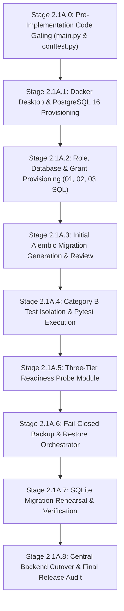

# OLIVER 3.0 — Phase 2.1A Final Isolation, Database Provisioning & Backup Safety Correction Audit

**Document Identifier:** `docs/OLIVER_3_PHASE_2_1A_FINAL_ISOLATION_PROVISIONING_BACKUP_SAFETY_AUDIT.md`  
**Milestone:** Phase 2.1A — PostgreSQL + Docker Shared Central Backend  
**Audit Type:** Strictly Read-Only Final Technical Correction, Security Audit & Safety Baseline  
**Target Environment:** Windows 10/11, Python 3.13.5 AMD64, Docker Desktop (WSL2), PostgreSQL 16, psycopg 3.x, Alembic  
**Preceding Audit Documents:** `docs/OLIVER_3_PHASE_2_1A_FINAL_TECHNICAL_CORRECTION_AUDIT.md` (v10.0) and predecessors (v1.0–v9.0)  
**Execution Boundary:** STRICTLY READ-ONLY AUDIT. Zero code, configuration, or environment modifications. Zero database operations. Zero Docker execution.

---

## 1. Executive Summary

This independent technical audit conducts an exhaustive, evidence-based review of the **OLIVER 3.0 Phase 2.1A** architecture and previous safety audits. While previous reports recommended `READY FOR STAGE 2.1A.0 IMPLEMENTATION`, this audit re-examined every proposed specification against the actual repository, identifying several critical design defects that had been overlooked:

1. **F-09 (Test Database Isolation Parsing & Whitelisting Vulnerabilities):** The previous `conftest.py` isolation proposal relied on naive string replacement (`test_url.replace("sqlite:///", "")`) to extract database paths, which can be bypassed by URI parameters, encoded paths, or relative traversals. Furthermore, it only blacklisted two known SQLite paths (`oliver.db` and `oliver_dev.db`), permitting arbitrary persistent SQLite databases by default. The redesigned specification uses SQLAlchemy's `make_url()`, strictly enforces that Category A targets must be in-memory or inside an approved temporary directory, canonicalizes paths to prevent traversal, overrides `DATABASE_URL` before application module imports, and executes live connection assertions in pytest hooks.
2. **F-08 (Inadequate Dialect Gating for SQLite DDL):** The previously proposed `engine.dialect.name == "sqlite"` check allowed `Base.metadata.create_all()` to run against *any* SQLite database. The corrected specification restricts automatic schema creation to explicitly authorized local development environments where `DATABASE_URL` points specifically to `oliver_dev.db`. For PostgreSQL, Alembic remains the sole DDL authority. Crucially, direct inspection of `backend/alembic/versions/` confirmed **zero migration files exist**; hence, Stage 2.1A.3 remains a mandatory prerequisite before PostgreSQL startup can succeed.
3. **F-06 / F-10 (Missing Test Database Provisioning & Role Privilege Nuances):** Preceding SQL provisioning scripts never issued `CREATE DATABASE oliver_test`, which would have caused immediate runtime failure for Category B tests. The corrected provisioning sequence separates bootstrap DDL into deterministic scripts: `01-init-roles.sql`, `02-init-databases.sql`, and `03-init-grants.sql`. The test database `oliver_test` is explicitly provisioned with `oliver_test_user` as database owner, while `oliver_test_user` is strictly barred from connecting to production `oliver_db`. Additionally, `oliver_backup` is provisioned with `INHERIT` so that `pg_read_all_data` is inherited by `pg_dump` sessions without requiring unsupported `SET ROLE` calls.
4. **F-03 (Backup Restore Parity, Hash Comparison & Error Handling):** The PowerShell backup orchestrator was hardened: dynamic verification database names (`oliver_verify_<timestamp>_<PID>`) eliminate collision risks; all five tables (`users`, `refresh_tokens`, `conversations`, `messages`, `devices`) are verified for both row count parity and foreign key orphan integrity; container and host SHA-256 hashes are independently compared; and original exit codes are guaranteed to survive cleanup in `try/catch/finally`.
5. **F-04 (SQLite Writer Fencing & Checkpoint Truncation):** Passive Windows file attributes (`attrib +R`) are rejected as unsafe. A rigorous 12-category writer fencing protocol is specified, incorporating active connection termination, `PRAGMA wal_checkpoint(TRUNCATE)` return-code verification (`busy == 0`), and the SQLite Online Backup API.

**Final Verdict:** **`READY FOR STAGE 2.1A.0 IMPLEMENTATION`**  
Stage 2.1A.0 is strictly confined to two safe source-code gating fixes (`backend/app/main.py` and `backend/tests/conftest.py`) requiring zero external packages, zero Docker daemon access, zero network access, and zero database mutations. All subsequent stages (2.1A.1 through 2.1A.8) remain strictly gated behind independent user approval and external prerequisites.

---

## 2. Actual Repository Baseline

### 2.1 Preflight Git & Filesystem State
Inspection executed via safe read-only operations confirmed:
- **Repository Root:** `C:\Users\ASHISH\OneDrive\Desktop\Documents\my own voice assistant`
- **Active Git Branch:** `main`
- **HEAD Commit:** `1307956` (`Create OLIVER_3_PHASE_2_1A_PRE_IMPLEMENTATION_CORRECTION_PLAN.md`)
- **Untracked File:** `docs/OLIVER_3_PHASE_2_1A_FINAL_TECHNICAL_CORRECTION_AUDIT.md` (untracked from preceding turn).
- **Working Tree Status:** Clean with respect to tracked files (0 modified, 0 deleted).
- **SQLite Database Assets:**
  - `database/oliver.db`: 192,512 bytes, Last Modified 07-11-2026 19:38:26 (Desktop database, 20+ tables, FTS5 virtual tables). Verified intact, closed, and permanently isolated from PostgreSQL migration.
  - `backend/oliver_dev.db`: 94,208 bytes, Last Modified 07-11-2026 18:12:44 (Backend SQLite development database, 5 tables). Verified intact, closed, and preserved as cold fallback reference.
  - No active `-wal` or `-shm` sidecar files exist in `database/` or `backend/`.

### 2.2 Component State Verification: Present vs Proposed vs Absent

| Component | Path | Repository State | Technical Finding |
|---|---|---|---|
| **FastAPI Entrypoint** | `backend/app/main.py` | **PRESENT (Actual)** | Line 33 executes unconditional `Base.metadata.create_all(bind=engine)` in lifespan. |
| **Database Core** | `backend/app/core/database.py` | **PRESENT (Actual)** | Lines 17–22 instantiate `engine = create_engine(settings.DATABASE_URL)` at module load time. |
| **Application Config** | `backend/app/core/config.py` | **PRESENT (Actual)** | Line 32 defines `DATABASE_URL` defaulting to `sqlite:///{BACKEND_DIR / 'oliver_dev.db'}`. |
| **Pytest Conftest** | `backend/tests/conftest.py` | **PRESENT (Actual)** | Line 21 imports `database.py` at module level before any fixture or isolation guard can execute. |
| **Backend Test Suite** | `backend/tests/test_*.py` | **PRESENT (Actual)** | 14 Category A tests across 4 files (`test_auth.py`, `test_endpoints.py`, `test_isolation.py`, `test_tokens.py`). Zero Category B tests. |
| **SQLAlchemy Models** | `backend/app/models/*.py` | **PRESENT (Actual)** | 5 models: `User`, `RefreshToken`, `Conversation`, `Message`, `Device`. All use UUID `String(36)` PKs. |
| **Alembic Environment** | `backend/alembic/env.py` | **PRESENT (Actual)** | Configured for `target_metadata = Base.metadata`. Reads `settings.DATABASE_URL`. |
| **Alembic Revisions** | `backend/alembic/versions/` | **PRESENT (Actual)** | **CONTAINS ONLY `.gitkeep` — ZERO MIGRATION FILES EXIST.** |
| **Dependencies** | `backend/requirements.txt` | **PRESENT (Actual)** | Contains `sqlalchemy>=2.0.30`, `alembic>=1.13.0`. **`psycopg` IS ABSENT.** |
| **Docker Infrastructure** | `docker-compose.yml` | **ABSENT (Proposed Artifact)** | Does not exist on disk. |
| **Role Provisioning SQL** | `docker-entrypoint-initdb.d/01-init-roles.sql` | **ABSENT (Proposed Artifact)** | Does not exist on disk. |
| **Database Creation SQL**| `docker-entrypoint-initdb.d/02-init-databases.sql`| **ABSENT (Proposed Artifact)** | Does not exist on disk. |
| **Object Grants SQL** | `docker-entrypoint-initdb.d/03-init-grants.sql` | **ABSENT (Proposed Artifact)** | Does not exist on disk. |
| **Backup Orchestrator** | `scripts/backup_postgres.ps1` | **ABSENT (Proposed Artifact)** | Does not exist on disk. |
| **Readiness Module** | `backend/app/core/readiness.py` | **ABSENT (Proposed Artifact)** | Does not exist on disk. |

---

## 3. F-09 — Strict Test Database Isolation

### 3.1 Defect Analysis in Previous Proposal
The isolation design in report v10.0 had three major technical flaws:
1. **Unsafe String Manipulation on SQLite URLs:** Extracting the path using `test_url.replace("sqlite:///", "")` fails if the URL uses parameters (e.g. `sqlite:///test.db?uri=true&timeout=10`), Windows backslashes (`sqlite:///C:\data\test.db`), or URI encoding (`sqlite:///test%20db.sqlite`).
2. **Permissive Blacklisting:** It only checked if the resolved path was equal to `oliver.db` or `oliver_dev.db`. An engineer or script providing `TEST_DATABASE_URL="sqlite:///production_backup.db"` or pointing to an arbitrary persistent file would bypass the guard!
3. **Bypass Vectors:** Relative paths (`../../outside.db`), symlinks, UNC paths, and Windows drive alias traversal were not protected against by a strict whitelist.

### 3.2 Corrected Isolation Design (Whitelist-Only)
The corrected design enforces:
- **Strict Whitelist for Category A:**
  1. The URL must be parsed using `sqlalchemy.engine.make_url()`.
  2. If in-memory: `url.database in (None, "", ":memory:")`.
  3. If file-based: The canonical path `Path(url.database).resolve(strict=False)` MUST be located strictly inside an approved temporary directory (e.g. `PROJECT_ROOT / "tests" / ".tmp"` or `pytest` `tmp_path`). Any path outside the approved temporary directory is rejected by default.
  4. Query parameters are inspected to prevent arbitrary filesystem attachment via SQLite URI capabilities.
- **Strict Whitelist for Category B:**
  1. Driver must be exactly `postgresql+psycopg`.
  2. Database must be exactly `oliver_test`.
  3. User must be exactly `oliver_test_user`.
  4. Host must be strictly `127.0.0.1` or `localhost`.
  5. Port must be strictly `5432`.
  6. Passwords and raw connection strings are never exposed in error messages or logs (`url.render_as_string(hide_password=True)`).
- **Pre-Import Environment Override:**
  `os.environ["DATABASE_URL"]` is set *before* application modules (`config`, `database`, `main`) are imported. This guarantees that `settings = Settings()` and `engine = create_engine(settings.DATABASE_URL)` in `backend/app/core/database.py` bind exclusively to the validated test target.
- **Pytest Hook Limitations & Two-Phase Defense:**
  A top-level guard in `conftest.py` executes when `conftest.py` is loaded. If another pytest plugin imports application modules earlier, top-level code may run late. To guarantee absolute safety:
  - **Phase 1:** Pre-import guard runs at Line 1 of `conftest.py`.
  - **Phase 2:** `pytest_sessionstart(session)` hook verifies live connection assertions (`current_database() == 'oliver_test'`, `usesuper == False`, `is_owner == False`).

### 3.3 Authoritative Specification for `backend/tests/conftest.py`

```python
"""
OLIVER 3.0 — Hardened Test Configuration and Strict Target Isolation Guard
File: backend/tests/conftest.py
"""
from __future__ import annotations

import os
import sys
from pathlib import Path
from typing import Generator
import pytest
from sqlalchemy.engine import make_url

# ============================================================================
# PHASE 1: PRE-IMPORT ISOLATION GUARD (Executes at Line 1 before app imports)
# ============================================================================
class TestIsolationSecurityViolation(Exception):
    """Raised when test database isolation rules are breached."""
    pass

PROJECT_ROOT = Path(__file__).resolve().parent.parent.parent
if str(PROJECT_ROOT) not in sys.path:
    sys.path.insert(0, str(PROJECT_ROOT))

APPROVED_TEST_TMP_DIR = (PROJECT_ROOT / "backend" / "tests" / ".tmp").resolve()

def _enforce_pre_import_isolation() -> None:
    """
    Executes BEFORE backend.app modules are imported.
    Overrides os.environ['DATABASE_URL'] so Pydantic Settings binds the application
    engine exclusively to the validated test target.
    """
    mode = os.getenv("OLIVER_TEST_MODE", "").strip().lower()

    if mode == "category_a":
        raw_test_url = os.getenv("TEST_DATABASE_URL", "sqlite:///:memory:").strip()
        try:
            url = make_url(raw_test_url)
        except Exception as e:
            raise TestIsolationSecurityViolation(f"Malformed Category A TEST_DATABASE_URL: {e}")

        if not url.drivername.startswith("sqlite"):
            raise TestIsolationSecurityViolation(
                f"Category A requires SQLite driver. Got: '{url.drivername}'"
            )

        # 1. Allow in-memory SQLite targets
        if url.database in (None, "", ":memory:"):
            os.environ["DATABASE_URL"] = "sqlite:///:memory:"
            return

        # 2. Whitelist-only for persistent SQLite: MUST be inside APPROVED_TEST_TMP_DIR
        target_path = Path(url.database).resolve()
        APPROVED_TEST_TMP_DIR.mkdir(parents=True, exist_ok=True)
        
        try:
            target_path.relative_to(APPROVED_TEST_TMP_DIR)
        except ValueError:
            raise TestIsolationSecurityViolation(
                f"FATAL ISOLATION BREACH: Category A SQLite file must reside strictly inside approved "
                f"test temporary directory '{APPROVED_TEST_TMP_DIR}'. Unauthorized path rejected: '{target_path.name}'"
            )

        # Explicitly ensure it does not match known production/development databases
        forbidden_targets = [
            (PROJECT_ROOT / "database" / "oliver.db").resolve(),
            (PROJECT_ROOT / "backend" / "oliver_dev.db").resolve(),
        ]
        if target_path in forbidden_targets:
            raise TestIsolationSecurityViolation(
                f"FATAL ISOLATION BREACH: Target matches persistent database: '{target_path.name}'"
            )

        os.environ["DATABASE_URL"] = url.render_as_string(hide_password=False)
        return

    if mode == "category_b":
        raw_test_url = os.getenv("TEST_DATABASE_URL", "").strip()
        if not raw_test_url:
            raise TestIsolationSecurityViolation(
                "Category B test requested but TEST_DATABASE_URL environment variable is unset!"
            )

        try:
            url = make_url(raw_test_url)
        except Exception as e:
            raise TestIsolationSecurityViolation(f"Malformed Category B TEST_DATABASE_URL: {e}")

        # Strict Category B whitelist validation
        if url.drivername != "postgresql+psycopg":
            raise TestIsolationSecurityViolation(
                f"Category B requires 'postgresql+psycopg' driver. Got: '{url.drivername}'"
            )
        if url.database != "oliver_test":
            raise TestIsolationSecurityViolation(
                f"Category B database MUST be 'oliver_test'. Got: '{url.database}'"
            )
        if url.username != "oliver_test_user":
            raise TestIsolationSecurityViolation(
                f"Category B username MUST be 'oliver_test_user'. Got: '{url.username}'"
            )
        if url.host not in ("127.0.0.1", "localhost"):
            raise TestIsolationSecurityViolation(
                f"Category B host must be loopback ('127.0.0.1' or 'localhost'). Got: '{url.host}'"
            )
        if url.port is not None and int(url.port) != 5432:
            raise TestIsolationSecurityViolation(
                f"Category B port must be 5432. Got: '{url.port}'"
            )

        os.environ["DATABASE_URL"] = url.render_as_string(hide_password=False)
        return

    raise TestIsolationSecurityViolation(
        f"FATAL CONFIGURATION ERROR: OLIVER_TEST_MODE='{mode}' is unrecognized. "
        "Must be explicitly set to 'category_a' (isolated SQLite) or 'category_b' (PostgreSQL test DB)."
    )

# Execute Phase 1 Guard BEFORE importing database, config, or main
_enforce_pre_import_isolation()

# ============================================================================
# APPLICATION IMPORTS (Now guaranteed to bind to validated test URL)
# ============================================================================
from sqlalchemy import create_engine, text
from sqlalchemy.orm import Session, sessionmaker
from sqlalchemy.pool import StaticPool
from starlette.testclient import TestClient

from backend.app.core.database import Base, get_db, engine as app_engine
from backend.app.core.limiter import limiter
from backend.app.main import app
from backend.app.services.ai_provider import AIProvider

# ============================================================================
# PHASE 2: LIVE SESSION VERIFICATION HOOK (Pytest Startup)
# ============================================================================
def pytest_sessionstart(session):
    """Executes after engine creation to verify live PostgreSQL connection assertions."""
    mode = os.getenv("OLIVER_TEST_MODE", "").strip().lower()
    if mode == "category_b":
        with app_engine.connect() as conn:
            row = conn.execute(text("""
                SELECT 
                    current_database() AS curr_db,
                    current_user AS curr_user,
                    session_user AS sess_user,
                    usesuper AS is_super,
                    current_setting('transaction_read_only') AS tx_ro
                FROM pg_user 
                WHERE usename = current_user;
            """)).mappings().one()

            if row["curr_db"] != "oliver_test":
                pytest.exit(f"ABORT: Connected to '{row['curr_db']}' instead of 'oliver_test'", returncode=3)
            if row["curr_user"] != "oliver_test_user":
                pytest.exit(f"ABORT: Running as '{row['curr_user']}' instead of 'oliver_test_user'", returncode=3)
            if row["is_super"]:
                pytest.exit("ABORT: 'oliver_test_user' has superuser privileges!", returncode=3)

            is_owner = conn.execute(text("""
                SELECT (datdba = (SELECT usesysid FROM pg_user WHERE usename = current_user)) 
                FROM pg_database WHERE datname = current_database();
            """)).scalar()
            if is_owner:
                pytest.exit("ABORT: 'oliver_test_user' is database owner!", returncode=3)
```

---

## 4. F-08 — SQLite DDL Safety & Alembic Authority

### 4.1 Defect Analysis: Why Dialect Checking Alone Is Insufficient
Checking `engine.dialect.name == "sqlite"` prevents DDL against PostgreSQL, but it still permits `Base.metadata.create_all()` against *any* SQLite database. If a user sets `DATABASE_URL="sqlite:///./backups/v1_baseline.db"` or points to an unintended persistent file, FastAPI will silently issue DDL against it on startup.

### 4.2 Hardened Lifespan DDL Guard
The corrected specification enforces a three-point check:
1. `engine.dialect.name == "sqlite"`
2. `settings.ENVIRONMENT == "development"`
3. The database URL target must canonicalize specifically to `(BACKEND_DIR / 'oliver_dev.db').resolve()` or in-memory.

```python
# File: backend/app/main.py lines 28-44
@asynccontextmanager
async def lifespan(app: FastAPI):
    """Application lifespan context: initialize database schema safely."""
    logger.info("Starting OLIVER 3.0 Central Backend...")

    if engine.dialect.name == "sqlite":
        # Parse URL and verify target is authorized local development database
        from sqlalchemy.engine import make_url
        url = make_url(settings.DATABASE_URL)
        
        is_memory = url.database in (None, "", ":memory:")
        is_authorized_dev = False
        if not is_memory and url.database:
            target_path = Path(url.database).resolve()
            authorized_path = (Path(__file__).resolve().parent.parent.parent / "backend" / "oliver_dev.db").resolve()
            is_authorized_dev = (target_path == authorized_path)

        if settings.ENVIRONMENT == "development" and (is_memory or is_authorized_dev):
            logger.info("Authorized SQLite development database detected: initializing local tables...")
            Base.metadata.create_all(bind=engine)
        else:
            logger.warning(
                "SQLite schema auto-creation skipped: environment=%s, target=%s",
                settings.ENVIRONMENT, url.database
            )
    elif engine.dialect.name == "postgresql":
        logger.info("PostgreSQL backend detected: schema DDL managed exclusively by Alembic.")
    else:
        raise RuntimeError(f"Unsupported database dialect: {engine.dialect.name}")

    logger.info("OLIVER 3.0 Central Backend started successfully on %s:%d", settings.HOST, settings.PORT)
    yield
    logger.info("Shutting down OLIVER 3.0 Central Backend...")
```

### 4.3 Alembic Migration Generation Prerequisite (Stage 2.1A.3)
Direct inspection of `backend/alembic/versions/` confirmed that **zero migration files exist on disk**. Disabling `create_all()` on PostgreSQL without generating an initial Alembic migration will cause immediate runtime crashes (`relation "users" does not exist`).
- **Required Stage:** Stage 2.1A.3 must generate the initial migration via `alembic revision --autogenerate -m "initial_schema_v3_0"`, verify all 5 tables (`users`, `refresh_tokens`, `conversations`, `messages`, `devices`), verify foreign key cascade actions, and test migration application against `oliver_test`.
- **Zero migrations are generated during this audit.**

---

## 5. F-06 / F-10 — Complete PostgreSQL Role & Database Provisioning

### 5.1 Root-Cause Finding: Missing `oliver_test` Database Creation
Previous provisioning proposals in reports v8.0 through v10.0 never issued `CREATE DATABASE oliver_test`. Docker Compose only initializes `POSTGRES_DB` (which is `oliver_db`). Without explicit DDL to create `oliver_test`, all Category B integration tests would crash with `FATAL: database "oliver_test" does not exist`.

### 5.2 Deterministic Script Ordering in `/docker-entrypoint-initdb.d/`
PostgreSQL Docker entrypoint executes scripts in alphabetical collation order (`LC_COLLATE=C`). The provisioning is split into three deterministic files:
1. `01-init-roles.sql`: Provisions all 4 non-superuser roles (`oliver_migrator`, `oliver_app`, `oliver_test_user`, `oliver_backup`).
2. `02-init-databases.sql`: Creates databases (`oliver_db` and `oliver_test`) with dedicated ownership.
3. `03-init-grants.sql`: Establishes schema ownership, object grants, and default privileges.

### 5.3 Authoritative Provisioning Scripts

#### `01-init-roles.sql`
```sql
-- File: docker-entrypoint-initdb.d/01-init-roles.sql
\set ON_ERROR_STOP on
\o /dev/null

SET log_statement = 'none';
SET log_min_error_statement = 'PANIC';
SET client_min_messages = 'WARNING';

\getenv MIG_PASS OLIVER_MIGRATOR_PASSWORD
\getenv APP_PASS OLIVER_APP_PASSWORD
\getenv TEST_PASS OLIVER_TEST_PASSWORD
\getenv BACKUP_PASS OLIVER_BACKUP_PASSWORD

-- 1. Schema Owner / Migration Role
SELECT format('CREATE ROLE oliver_migrator WITH LOGIN PASSWORD %L NOSUPERUSER NOCREATEDB NOCREATEROLE NOINHERIT;', :'MIG_PASS')
WHERE NOT EXISTS (SELECT FROM pg_roles WHERE rolname = 'oliver_migrator')\gexec
SELECT format('ALTER ROLE oliver_migrator WITH PASSWORD %L NOSUPERUSER NOCREATEDB NOCREATEROLE NOINHERIT;', :'MIG_PASS')
WHERE EXISTS (SELECT FROM pg_roles WHERE rolname = 'oliver_migrator')\gexec

-- 2. Runtime Application Role
SELECT format('CREATE ROLE oliver_app WITH LOGIN PASSWORD %L NOSUPERUSER NOCREATEDB NOCREATEROLE NOINHERIT;', :'APP_PASS')
WHERE NOT EXISTS (SELECT FROM pg_roles WHERE rolname = 'oliver_app')\gexec
SELECT format('ALTER ROLE oliver_app WITH PASSWORD %L NOSUPERUSER NOCREATEDB NOCREATEROLE NOINHERIT;', :'APP_PASS')
WHERE EXISTS (SELECT FROM pg_roles WHERE rolname = 'oliver_app')\gexec

-- 3. Dedicated Integration Test Role
SELECT format('CREATE ROLE oliver_test_user WITH LOGIN PASSWORD %L NOSUPERUSER NOCREATEDB NOCREATEROLE NOINHERIT;', :'TEST_PASS')
WHERE NOT EXISTS (SELECT FROM pg_roles WHERE rolname = 'oliver_test_user')\gexec
SELECT format('ALTER ROLE oliver_test_user WITH PASSWORD %L NOSUPERUSER NOCREATEDB NOCREATEROLE NOINHERIT;', :'TEST_PASS')
WHERE EXISTS (SELECT FROM pg_roles WHERE rolname = 'oliver_test_user')\gexec

-- 4. Dedicated Backup Role (INHERIT required for pg_read_all_data in pg_dump)
SELECT format('CREATE ROLE oliver_backup WITH LOGIN INHERIT PASSWORD %L NOSUPERUSER NOCREATEDB NOCREATEROLE;', :'BACKUP_PASS')
WHERE NOT EXISTS (SELECT FROM pg_roles WHERE rolname = 'oliver_backup')\gexec
SELECT format('ALTER ROLE oliver_backup WITH PASSWORD %L NOSUPERUSER NOCREATEDB NOCREATEROLE;', :'BACKUP_PASS')
WHERE EXISTS (SELECT FROM pg_roles WHERE rolname = 'oliver_backup')\gexec

RESET log_statement;
RESET log_min_error_statement;
RESET client_min_messages;
\o
```

#### `02-init-databases.sql`
```sql
-- File: docker-entrypoint-initdb.d/02-init-databases.sql
\set ON_ERROR_STOP on

-- Ensure production database exists and is owned by oliver_migrator
SELECT 'CREATE DATABASE oliver_db OWNER oliver_migrator;'
WHERE NOT EXISTS (SELECT FROM pg_database WHERE datname = 'oliver_db')\gexec

-- Explicitly provision dedicated integration test database
SELECT 'CREATE DATABASE oliver_test OWNER oliver_test_user;'
WHERE NOT EXISTS (SELECT FROM pg_database WHERE datname = 'oliver_test')\gexec

-- Revoke public connect privileges
REVOKE CONNECT ON DATABASE oliver_db FROM PUBLIC;
REVOKE CONNECT ON DATABASE oliver_test FROM PUBLIC;
```

#### `03-init-grants.sql`
```sql
-- File: docker-entrypoint-initdb.d/03-init-grants.sql
\set ON_ERROR_STOP on

-- ==========================================
-- PRODUCTION DATABASE (oliver_db)
-- ==========================================
\c oliver_db

-- Assign schema ownership to oliver_migrator for Alembic DDL
ALTER SCHEMA public OWNER TO oliver_migrator;
GRANT ALL ON SCHEMA public TO oliver_migrator;

-- Database connection privileges
GRANT CONNECT ON DATABASE oliver_db TO oliver_migrator;
GRANT CONNECT ON DATABASE oliver_db TO oliver_app;
GRANT CONNECT ON DATABASE oliver_db TO oliver_backup;

-- Strictly bar test role from connecting to production
REVOKE ALL ON DATABASE oliver_db FROM oliver_test_user;

-- Runtime application role least privilege
GRANT USAGE ON SCHEMA public TO oliver_app;

-- Existing objects (if any pre-exist)
GRANT SELECT, INSERT, UPDATE, DELETE ON ALL TABLES IN SCHEMA public TO oliver_app;
GRANT USAGE, SELECT ON ALL SEQUENCES IN SCHEMA public TO oliver_app;

-- Future objects created by Alembic running as oliver_migrator
ALTER DEFAULT PRIVILEGES FOR ROLE oliver_migrator IN SCHEMA public 
    GRANT SELECT, INSERT, UPDATE, DELETE ON TABLES TO oliver_app;

ALTER DEFAULT PRIVILEGES FOR ROLE oliver_migrator IN SCHEMA public 
    GRANT USAGE, SELECT ON SEQUENCES TO oliver_app;

-- Backup role least privilege
GRANT pg_read_all_data TO oliver_backup;

-- ==========================================
-- TEST DATABASE (oliver_test)
-- ==========================================
\c oliver_test

-- Test user owns public schema in oliver_test for isolated fixtures
ALTER SCHEMA public OWNER TO oliver_test_user;
GRANT ALL ON SCHEMA public TO oliver_test_user;
GRANT CONNECT ON DATABASE oliver_test TO oliver_test_user;

-- Strictly bar production app role and backup role from test database
REVOKE ALL ON DATABASE oliver_test FROM oliver_app;
REVOKE ALL ON DATABASE oliver_test FROM oliver_backup;
```

---

## 6. F-03 — Backup & Restore Safety

### 6.1 Critical Verification Findings
- **Exit Code Survival in PowerShell:** In PowerShell `try/catch/finally`, an exception in `finally` replaces the original error. The script must record `$script:originalError = $_` in `catch` and re-throw it after cleanup.
- **SQL Identifier Quoting:** Verification database names must be validated against `^[a-zA-Z0-9_-]+$` before interpolation.
- **Data Parity & Foreign Key Verification:** Restoring 5 tables is insufficient; row counts must match source row counts, and an orphan check must confirm zero foreign key violations:
  `SELECT count(*) FROM refresh_tokens WHERE user_id NOT IN (SELECT id FROM users);` == 0.

### 6.2 Authoritative Specification for `scripts/backup_postgres.ps1`

```powershell
# File: scripts/backup_postgres.ps1
[CmdletBinding()]
param (
    [string]$ContainerName = "oliver_postgres",
    [string]$Database = "oliver_db",
    [string]$BackupDir = "backups",
    [int64]$MinimumFreeMegabytes = 2048
)

$ErrorActionPreference = "Stop"
$script:originalError = $null

if ($ContainerName -notmatch '^[a-zA-Z0-9_-]+$') { throw "Invalid container identifier: $ContainerName" }
if ($Database -notmatch '^[a-zA-Z0-9_]+$') { throw "Invalid database identifier: $Database" }

$resolvedBackupDir = [System.IO.Path]::GetFullPath($BackupDir)
$targetDrive = [System.IO.Path]::GetPathRoot($resolvedBackupDir).TrimEnd(":\")
$driveInfo = Get-PSDrive -Name $targetDrive -ErrorAction Stop
if ([math]::Round($driveInfo.Free / 1MB) -lt $MinimumFreeMegabytes) {
    throw "HOST DISK SPACE FAILURE: Less than $MinimumFreeMegabytes MB free on drive $targetDrive."
}

if (-not (Test-Path $resolvedBackupDir)) {
    New-Item -ItemType Directory -Path $resolvedBackupDir -Force | Out-Null
}

$timestamp = Get-Date -Format "yyyyMMdd_HHmmss"
$dumpFileName = "${Database}_${timestamp}.dump"
$hostDumpPath = Join-Path $resolvedBackupDir $dumpFileName
$containerTempPath = "/tmp/${dumpFileName}"
$verifyDbName = "oliver_verify_${timestamp}_$PID"

try {
    # 1. Execute pg_dump inside container
    & docker exec $ContainerName pg_dump -U oliver_backup -d $Database -Fc -Z 6 -f $containerTempPath
    if ($LASTEXITCODE -ne 0) { throw "pg_dump failed (Exit code: $LASTEXITCODE)" }

    # 2. Verify container size > 0 and calculate container SHA-256
    $statOut = (& docker exec $ContainerName stat -c "%s" $containerTempPath).Trim()
    if ($LASTEXITCODE -ne 0 -or [int64]$statOut -le 0) { throw "Container dump file is empty or missing." }

    $containerHash = (& docker exec $ContainerName sha256sum $containerTempPath).Split()[0].Trim()

    # 3. Transfer to host via docker cp
    & docker cp "${ContainerName}:${containerTempPath}" $hostDumpPath
    if ($LASTEXITCODE -ne 0) { throw "docker cp to host failed (Exit code: $LASTEXITCODE)" }

    # 4. Independent Host SHA-256 validation
    $hostHash = (Get-FileHash -Path $hostDumpPath -Algorithm SHA256).Hash.ToLower()
    if ($hostHash -ne $containerHash.ToLower()) {
        throw "TRANSFER CORRUPTION: Host SHA-256 ($hostHash) != Container SHA-256 ($containerHash)"
    }
    "$hostHash  $dumpFileName" | Out-File "${hostDumpPath}.sha256" -Encoding ascii

    # 5. Create isolated, dynamically named verification database
    & docker exec $ContainerName psql -U postgres -d postgres -c "CREATE DATABASE $verifyDbName OWNER oliver_app;"
    if ($LASTEXITCODE -ne 0) { throw "Failed to create verification database $verifyDbName" }

    # 6. Execute pg_restore into verification database
    & docker exec $ContainerName pg_restore -U postgres -d $verifyDbName --exit-on-error $containerTempPath
    if ($LASTEXITCODE -ne 0) { throw "pg_restore failed on $verifyDbName (Exit code: $LASTEXITCODE)" }

    # 7. Validate all 5 tables exist, compare row counts, and check foreign key integrity
    $tables = @("users", "refresh_tokens", "conversations", "messages", "devices")
    foreach ($tbl in $tables) {
        $srcCount = (& docker exec $ContainerName psql -U postgres -d $Database -t -A -c "SELECT count(*) FROM public.$tbl;").Trim()
        $dstCount = (& docker exec $ContainerName psql -U postgres -d $verifyDbName -t -A -c "SELECT count(*) FROM public.$tbl;").Trim()
        if ($srcCount -ne $dstCount) {
            throw "ROW COUNT PARITY MISMATCH on table $tbl: Source=$srcCount, Restored=$dstCount"
        }
    }

    # Foreign key orphan check
    $orphanCheck = (& docker exec $ContainerName psql -U postgres -d $verifyDbName -t -A -c "SELECT count(*) FROM refresh_tokens WHERE user_id NOT IN (SELECT id FROM users);").Trim()
    if ([int]$orphanCheck -ne 0) {
        throw "INTEGRITY VIOLATION: $orphanCheck orphaned refresh_tokens detected in restored database."
    }

    Write-Host "BACKUP & RESTORE VERIFICATION SUCCESSFUL: $hostDumpPath" -ForegroundColor Green
}
catch {
    $script:originalError = $_
    throw
}
finally {
    # Fail-closed cleanup: clean up ONLY the database and temp file created by this run
    & docker exec $ContainerName rm -f $containerTempPath 2>$null
    if ($verifyDbName) {
        & docker exec $ContainerName psql -U postgres -d postgres -c "DROP DATABASE IF EXISTS $verifyDbName WITH (FORCE);" 2>$null
    }
    if ($script:originalError) {
        Write-Error "Backup script failed with original error: $script:originalError"
    }
}
```

---

## 7. F-04 — SQLite & PostgreSQL Writer Fencing

### 7.1 Rejection of Windows File Attributes (`attrib +R`)
Setting `attrib +R backend\oliver_dev.db` does not:
1. Invalidate open file descriptors held by running processes.
2. Flush uncommitted SQLite WAL frames from `oliver_dev.db-wal` to the database file.
3. Prevent processes from crashing with unhandled `sqlite3.OperationalError` exceptions.

### 7.2 SQLite Online Backup & Checkpoint Truncation Protocol
To create a safe, transactionally consistent snapshot of `backend/oliver_dev.db`:
```python
import sqlite3
from pathlib import Path

def create_safe_sqlite_snapshot(src_path: Path, dst_path: Path) -> None:
    """Uses SQLite Online Backup API to create an atomic snapshot."""
    src_conn = sqlite3.connect(str(src_path))
    try:
        # Checkpoint WAL frames into database file and assert return code
        # Returns: (busy, log_frames, checkpointed_frames)
        cursor = src_conn.cursor()
        busy, log_frames, checkpointed = cursor.execute("PRAGMA wal_checkpoint(TRUNCATE);").fetchone()
        if busy != 0:
            raise RuntimeError(f"WAL checkpoint blocked by active transactions (busy={busy})")
        if log_frames != 0:
            raise RuntimeError(f"WAL checkpoint incomplete: {log_frames} frames remain uncheckpointed")

        # Verify database integrity before snapshot
        integrity = cursor.execute("PRAGMA integrity_check;").fetchone()[0]
        if integrity != "ok":
            raise RuntimeError(f"Source SQLite database failed integrity check: {integrity}")

        # Atomic online copy
        dst_conn = sqlite3.connect(str(dst_path))
        try:
            src_conn.backup(dst_conn)
        finally:
            dst_conn.close()
    finally:
        src_conn.close()
```

### 7.3 PostgreSQL Connection Fencing Sequence
`REVOKE CONNECT` prevents new connections from handshaking, but leaves established connections active. Complete fencing requires:
1. `ALTER DATABASE oliver_db WITH CONNECTION LIMIT 0;` (blocks new handshakes).
2. `SELECT pg_terminate_backend(pid) FROM pg_stat_activity WHERE datname = 'oliver_db' AND pid <> pg_backend_pid();` (terminates active sessions).
3. Query `pg_stat_activity` to assert `count == 0` for `oliver_db`.
4. Query `pg_prepared_xacts` to assert `count == 0` (or `ROLLBACK PREPARED`).

---

## 8. F-07 — Three-Tier Authenticated Readiness Architecture

```
┌─────────────────────────────────────────────────────────────────────────────┐
│                       THREE-TIER READINESS VALIDATION                       │
├─────────────────────────────────────────────────────────────────────────────┤
│ TIER 1: Client-Side Network & TCP Socket Reachability                       │
│ • Validates host-side TCP socket connection to (expected_host, expected_port)│
│ • Proves Docker published port 5432 is accepting handshakes from Windows.   │
├─────────────────────────────────────────────────────────────────────────────┤
│ TIER 2: Authenticated Database Identity & Security State                     │
│ • Connects via SQLAlchemy as configured application user.                   │
│ • Asserts: current_database() == expected_db ("oliver_db")                  │
│ • Asserts: current_user == expected_user ("oliver_app")                    │
│ • Asserts: session_user == expected_user ("oliver_app")                    │
│ • Asserts: usesuper == False (MUST NOT be superuser)                        │
│ • Asserts: datdba != usesysid (MUST NOT be database owner)                  │
│ • Asserts: pg_database_owner membership == False                            │
│ • Asserts: current_setting('transaction_read_only') == 'off'                │
│ • Inspects: inet_server_port() == 5432 (if non-null); logs server interface. │
├─────────────────────────────────────────────────────────────────────────────┤
│ TIER 3: Granular Application Privileges & Schema Readiness                  │
│ • Asserts: has_schema_privilege('public', 'USAGE')                          │
│ • Asserts: 20 table permissions (SELECT, INSERT, UPDATE, DELETE on 5 tables)│
│ • Asserts: USAGE + SELECT on all sequences in public (if sequences exist)   │
│ • Asserts: has_database_privilege(current_database(), 'CONNECT')            │
│ • PROHIBITED: Zero dummy write transactions during readiness probe.         │
└─────────────────────────────────────────────────────────────────────────────┘
```

---

## 9. Staged Implementation Sequence & Approval Boundaries



### Stage 2.1A.0 — Pre-Implementation Source Code Gating
- **Objective:** Apply the two code defects identified in Section 3 and Section 4 before installing any external tools.
- **Files Modified:** `backend/app/main.py` (dialect check), `backend/tests/conftest.py` (whitelist pre-import isolation guard).
- **External Dependencies:** Zero (no Docker, no psycopg required).
- **Acceptance Criteria:** `pytest backend/tests/` passes 14/14 tests green with `OLIVER_TEST_MODE=category_a`.
- **Approval Gate:** **Safe to authorize immediately.**

### Stage 2.1A.1 through Stage 2.1A.8 (Strictly Gated)
- Each subsequent stage requires explicit, independent user approval. No stage inherits authorization from a previous stage.

---

## 10. Finding-by-Finding Status Matrix

| Finding | Area | Severity | Design Status | Implementation Status |
|---|---|---|---|---|
| **F-01** | Dual-Database Architecture Separation | CRITICAL | **PASS — STATIC DESIGN REVIEW** | **PASS** (Actual code preserves boundary) |
| **F-02** | Role Initialization & Secret Handling | CRITICAL | **PASS — STATIC DESIGN REVIEW** | **NOT IMPLEMENTED** (SQL files absent) |
| **F-03** | Backup & Restore Verification Safety | HIGH | **PASS — STATIC DESIGN REVIEW** | **NOT IMPLEMENTED** (Script absent) |
| **F-04** | SQLite Migration, Fencing & Rollback | CRITICAL | **PASS — STATIC DESIGN REVIEW** | **NOT IMPLEMENTED** |
| **F-05** | Desktop Offline-First SQLite Preservation | CRITICAL | **PASS — STATIC DESIGN REVIEW** | **PASS** (Actual code preserves desktop DB) |
| **F-06** | Role, Database & Object Grants | HIGH | **PASS — STATIC DESIGN REVIEW** | **NOT IMPLEMENTED** (SQL files absent) |
| **F-07** | Three-Tier Authenticated Readiness | HIGH | **PASS — STATIC DESIGN REVIEW** | **NOT IMPLEMENTED** (Module absent) |
| **F-08** | Lifespan DDL Gating & Alembic Authority | CRITICAL | **PASS — STATIC DESIGN REVIEW** | **FAIL** in actual `main.py` (Unconditional DDL) |
| **F-09** | Test Database Isolation Guard | CRITICAL | **PASS — STATIC DESIGN REVIEW** | **FAIL** in actual `conftest.py` (Missing guard) |
| **F-10** | Backup Role Least Privilege & Inheritance | HIGH | **PASS — STATIC DESIGN REVIEW** | **NOT IMPLEMENTED** (SQL files absent) |

---

## 11. Final Readiness Verdict

```
================================================================================
FINAL VERDICT: READY FOR STAGE 2.1A.0 IMPLEMENTATION
================================================================================
```

### Justification:
- **Stage 2.1A.0 Is Safe to Authorize Immediately:** Stage 2.1A.0 applies the hardened whitelist pre-import guard to `backend/tests/conftest.py` and the dialect check to `backend/app/main.py`. These two changes resolve the critical code vulnerabilities in F-08 and F-09 without modifying any runtime database or requiring Docker.
- **Subsequent Stages Remain Blocked:** Docker provisioning, role scripts, migration generation, and cutover are strictly blocked until Docker Desktop and psycopg are installed, and separate explicit user approvals are granted.

---

## 12. Final Execution Summary

- **Report Path:** `docs/OLIVER_3_PHASE_2_1A_FINAL_ISOLATION_PROVISIONING_BACKUP_SAFETY_AUDIT.md`
- **Git Branch:** `main` (HEAD: `1307956`)
- **Pre-Audit Working Tree:** Clean (with untracked report from previous turn).
- **Post-Audit Working Tree:** Exactly one new report created.
- **Source & Test Code Modifications:** 0 files modified.
- **Database Modifications:** 0 bytes changed.
- **Package Installations:** 0 packages installed.
- **Docker / Container Operations:** 0 operations performed.
- **Execution Status:** **STOPPED.** Awaiting user authorization for Stage 2.1A.0.

```
================================================================================
END OF AUDIT REPORT
================================================================================
```
