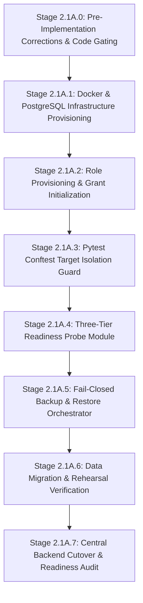

# OLIVER 3.0 — Phase 2.1A Pre-Implementation Correction Plan & Repository Safety Assessment

**Document Identifier:** `docs/OLIVER_3_PHASE_2_1A_PRE_IMPLEMENTATION_CORRECTION_PLAN.md`  
**Milestone:** Phase 2.1A — PostgreSQL + Docker Pre-Implementation & Safety Baseline  
**Document Type:** Strictly Read-Only Correction Plan & Architectural Baseline  
**Author Roles:** Senior Python Backend Architect, PostgreSQL Database Engineer, DevOps Engineer, Application Security Auditor  
**Preceding Audit Decision:** `CONDITIONAL PASS — SPECIFIC BLOCKERS REMAIN` (`docs/OLIVER_3_PHASE_2_1_FINAL_REMAINING_DEFECTS_CLOSURE_AUDIT.md`)  
**Execution Boundary:** STRICTLY READ-ONLY PLANNING. Zero code mutations, zero package installations, zero container execution, zero database operations.

---

## 1. Executive Summary

This pre-implementation plan establishes the definitive, minimal, and safe technical path to commence **Phase 2.1A (PostgreSQL + Docker Shared Backend Migration)** for OLIVER 3.0. 

A rigorous read-only inspection of the active repository confirmed the central finding of the latest audit:
**All proposed infrastructure artifacts from prior planning rounds (Docker Compose, role initialization SQL, PowerShell backup orchestrator, three-tier readiness probe, and test isolation guard) exist exclusively as text in Markdown reports. Zero Phase 2.1 implementation artifacts have been committed to disk.**

Furthermore, inspection of the actual repository source code revealed four tangible structural defects that must be resolved prior to container cutover:
1. **F-08 Code Defect:** `backend/app/main.py` line 33 unconditionally executes `Base.metadata.create_all(bind=engine)` during FastAPI lifespan startup, which would bypass Alembic and perform unmanaged DDL against production PostgreSQL.
2. **F-09 Code Defect:** `backend/tests/conftest.py` line 21 imports `backend.app.core.database` at the top level, creating the production engine against `DATABASE_URL` at module load time before any pytest hook can establish isolation.
3. **F-06 Specification Defect:** Proposed role grants omitted `FOR ROLE oliver_migrator` in `ALTER DEFAULT PRIVILEGES`, meaning tables created by Alembic would not grant access to `oliver_app`. Additionally, `oliver_migrator` was never provisioned in the proposed `01-init-roles.sql`.
4. **F-07 Specification Defect:** The proposed `check_tier2_session()` in `readiness.py` accepted `expected_host` and `expected_port` as parameters but never compared them against `inet_server_addr()` or `inet_server_port()`, leaving endpoint validation as a no-op.

This document resolves each defect with surgical, minimal corrections, presents a staged roadmap with eight strict user-approval gates (Stage 2.1A.0 through Stage 2.1A.7), and formalizes the technical prerequisites for implementation.

**Final Decision:** **`READY WITH CONDITIONS`**

---

## 2. Repository & Git Baseline

### 2.1 Preflight State Inspection
Inspection executed using read-only Git commands confirmed:
- **Project Root:** `C:\Users\ASHISH\OneDrive\Desktop\Documents\my own voice assistant`
- **Active Branch:** `main`
- **HEAD Commit:** `c57bcd6` (`Create OLIVER_3_PHASE_2_1_FINAL_REMAINING_DEFECTS_CLOSURE_AUDIT.md`)
- **Working Tree:** Completely clean (`git status --short` returned 0 modified, 0 deleted, 0 untracked files).

### 2.2 Host Runtime & Environment Status (Read-Only)
- **Docker CLI / Engine:** Not installed or not available on system PATH (`Get-Command docker` returned nothing).
- **PostgreSQL Driver (`psycopg`):** Not installed in Python 3.13.5 environment (`ModuleNotFoundError: No module named 'psycopg'`).
- **PostgreSQL Services:** No local PostgreSQL daemons or background processes active on port 5432.
- **SQLite Database Assets:**
  - `database/oliver.db`: 192,512 bytes, Last Modified 07-11-2026 19:38:26 (Desktop database, 20+ tables, FTS5 virtual tables). Preserved intact.
  - `backend/oliver_dev.db`: 94,208 bytes, Last Modified 07-11-2026 18:12:44 (Backend SQLite development database, 5 tables). Preserved intact.
  - No active WAL (`-wal`) or Shared Memory (`-shm`) files exist in `database/` or `backend/`.

---

## 3. Actual File Inventory: Present vs Absent

| Component | Path | Status | Verification & Finding |
|---|---|---|---|
| **App Entrypoint** | `backend/app/main.py` | **PRESENT** (96 lines) | Contains unconditional `Base.metadata.create_all` at line 33. |
| **Database Core** | `backend/app/core/database.py` | **PRESENT** (47 lines) | Creates `engine = create_engine(...)` at module load time (lines 17–22). |
| **App Config** | `backend/app/core/config.py` | **PRESENT** (62 lines) | Defines `DATABASE_URL` default to `sqlite:///{BACKEND_DIR / 'oliver_dev.db'}` (line 32). |
| **Pytest Conftest** | `backend/tests/conftest.py` | **PRESENT** (96 lines) | Imports `database.py` at line 21 before isolation guards can run. |
| **Backend Tests** | `backend/tests/test_*.py` | **PRESENT** (4 files) | 14 Category A tests using `sqlite:///:memory:`. Zero Category B PostgreSQL tests. |
| **ORM Models** | `backend/app/models/*.py` | **PRESENT** (5 models) | `User`, `RefreshToken`, `Conversation`, `Message`, `Device`. All use UUID `String(36)` PKs. |
| **Alembic Env** | `backend/alembic/env.py` | **PRESENT** (57 lines) | Configured for `target_metadata = Base.metadata`. Reads `settings.DATABASE_URL`. |
| **Alembic Config** | `backend/alembic.ini` | **PRESENT** (43 lines) | Points to `sqlite:///./backend/oliver_dev.db`. |
| **Alembic Versions** | `backend/alembic/versions/` | **PRESENT** (.gitkeep only) | Zero migration revisions exist on disk. |
| **Requirements** | `backend/requirements.txt` | **PRESENT** (11 packages) | Has `sqlalchemy>=2.0.30`, `alembic>=1.13.0`. Does **NOT** have `psycopg`. |
| **Docker Compose** | `docker-compose.yml` | **ABSENT — PROPOSED ARTIFACT NOT IMPLEMENTED** | No container infrastructure file exists in repository. |
| **Init SQL** | `docker-entrypoint-initdb.d/01-init-roles.sql` | **ABSENT — PROPOSED ARTIFACT NOT IMPLEMENTED** | No role provisioning SQL script exists on disk. |
| **Backup Script** | `scripts/backup_postgres.ps1` | **ABSENT — PROPOSED ARTIFACT NOT IMPLEMENTED** | Only `scripts/test.ps1` exists (pre-existing test runner). |
| **Readiness Module** | `backend/app/core/readiness.py` | **ABSENT — PROPOSED ARTIFACT NOT IMPLEMENTED** | No health probe or privilege verification module exists. |

---

## 4. Finding-by-Finding Assessment

### F-06 — PostgreSQL Role & Privilege Architecture
- **Status:** **`FAIL`** in previous specification; **`RESOLVED IN PLAN`** below.
- **Defects Identified:**
  1. `ALTER DEFAULT PRIVILEGES IN SCHEMA public ...` in report v8.0 lines 660–661 omitted `FOR ROLE oliver_migrator`. Without this clause, default privileges apply only to objects created by the executing role (typically `postgres`), meaning objects created by Alembic running as `oliver_migrator` would be inaccessible to `oliver_app`.
  2. The proposed `01-init-roles.sql` in report v8.0 provisioned `oliver_app`, `oliver_test_user`, and `oliver_backup`, but completely omitted provisioning the `oliver_migrator` role.
  3. No role provisioning or grant script exists on disk.
- **Minimum Proposed Correction:**
  1. Add `oliver_migrator` provisioning to `01-init-roles.sql` with login credentials read via `\getenv MIG_PASS OLIVER_MIGRATOR_PASSWORD`.
  2. Grant schema ownership or `CREATE` privileges on schema `public` to `oliver_migrator`.
  3. Formulate default privileges explicitly as:
     `ALTER DEFAULT PRIVILEGES FOR ROLE oliver_migrator IN SCHEMA public GRANT SELECT, INSERT, UPDATE, DELETE ON TABLES TO oliver_app;`
     `ALTER DEFAULT PRIVILEGES FOR ROLE oliver_migrator IN SCHEMA public GRANT USAGE, SELECT ON SEQUENCES TO oliver_app;`

### F-07 — PostgreSQL Authenticated Readiness & Endpoint Validation
- **Status:** **`FAIL`** in previous specification; **`RESOLVED IN PLAN`** below.
- **Defects Identified:**
  1. In report v8.0 line 409, `check_tier2_session(engine, expected_host="127.0.0.1", expected_port=5432)` declared `expected_host` and `expected_port`, but lines 411–455 never compared these values against `srv_addr` or `srv_port`.
  2. When connecting over local Unix domain sockets or named pipes, `inet_server_addr()` and `inet_server_port()` return `NULL`. The code lacked NULL-safe handling and did not fail closed when TCP endpoint verification was required.
  3. `backend/app/core/readiness.py` does not exist on disk.
- **Minimum Proposed Correction:**
  1. Implement explicit comparisons:
     ```python
     if expected_port is not None:
         if srv_port is None or int(srv_port) != int(expected_port):
             raise ReadinessProbeFailure(f"Port mismatch: expected {expected_port}, got {srv_port}")
     if expected_host is not None:
         if srv_addr is None or str(srv_addr) not in (expected_host, "127.0.0.1", "::1"):
             raise ReadinessProbeFailure(f"Host mismatch: expected {expected_host}, got {srv_addr}")
     ```
  2. Handle socket/NULL returns: If `srv_addr` is NULL and connection was configured via TCP URL (`host != ""` and `host != "localhost"`), fail closed immediately.

### F-08 — SQLAlchemy Schema Initialization
- **Status:** **`FAIL`** in current code; **`RESOLVED IN PLAN`** below.
- **Defects Identified:**
  - `backend/app/main.py` lines 30–34:
    ```python
    @asynccontextmanager
    async def lifespan(app: FastAPI):
        logger.info("Initializing database schema for OLIVER 3.0...")
        Base.metadata.create_all(bind=engine)  # <-- UNCONDITIONAL DDL EXECUTION
        yield
    ```
    This executes during every application startup. If `DATABASE_URL` points to PostgreSQL, SQLAlchemy will attempt to issue DDL (`CREATE TABLE IF NOT EXISTS`) directly against PostgreSQL, bypassing Alembic schema versioning and risking permission errors or schema divergence.
- **Minimum Proposed Correction:**
  Gate `create_all` strictly to SQLite:
  ```python
  @asynccontextmanager
  async def lifespan(app: FastAPI):
      logger.info("Starting OLIVER 3.0 Central Backend...")
      if settings.DATABASE_URL.startswith("sqlite"):
          logger.info("Development SQLite detected: ensuring local tables exist...")
          Base.metadata.create_all(bind=engine)
      else:
          logger.info("PostgreSQL production backend detected: schema managed exclusively by Alembic.")
      yield
  ```

### F-09 — Test Database Isolation & Pytest Guard Ordering
- **Status:** **`FAIL`** in current code; **`RESOLVED IN PLAN`** below.
- **Defects Identified:**
  - `backend/tests/conftest.py` line 21: `from backend.app.core.database import Base, get_db`.
  - When pytest loads `conftest.py`, Python imports `database.py`, which executes lines 17–22 (`engine = create_engine(settings.DATABASE_URL)`). If `DATABASE_URL` is misconfigured or set to production, an engine bound to the live database is instantiated at module import time, before any fixture or pytest hook can run.
  - The proposed isolation guard in report v8.0 had not been applied to `conftest.py`.
- **Minimum Proposed Correction:**
  1. Insert a top-level guard function `enforce_isolation_guard()` at line 1 of `conftest.py` **before any application imports**.
  2. For `OLIVER_TEST_MODE=category_a`: Resolve the test database path and explicitly reject `database/oliver.db` and `backend/oliver_dev.db`.
  3. For `OLIVER_TEST_MODE=category_b`: Validate that `TEST_DATABASE_URL` begins with `postgresql+psycopg://`, connect to PostgreSQL, and verify `current_user == 'oliver_test_user'`, `current_database == 'oliver_test'`, `usesuper == False`, and `srv_port == 5432`.
  4. Prohibit all `assert` statements in the guard; use explicit `if not condition: raise TestIsolationSecurityViolation(...)`.

### F-03 — Backup, Restore, and Verification Safety
- **Status:** **`PARTIAL`** in previous specification; **`RESOLVED IN PLAN`** below.
- **Defects Identified:**
  1. The verification restore database used a fixed name (`oliver_restore_verify`), creating race conditions or collision risks if runs overlapped or previous runs left stale state.
  2. Table verification checked only table existence (`count(*) == 5`), without verifying representative row counts or constraint integrity.
  3. SHA-256 hash was generated on the host file but never compared against an independent reference.
  4. Cleanup in `finally` used `Write-Warning` rather than recording unresolved failures.
  5. `scripts/backup_postgres.ps1` does not exist on disk.
- **Minimum Proposed Correction:**
  1. Generate a unique, per-run verification database name: `oliver_verify_${timestamp}_${PID}`.
  2. Perform row-count checks across all 5 tables (`users`, `refresh_tokens`, `conversations`, `messages`, `devices`).
  3. Compare container dump SHA-256 with host dump SHA-256 to prove byte-level transfer fidelity.
  4. Implement fail-closed cleanup tracking.

### F-04 — Complete Write Freeze & Recovery Guarantees
- **Status:** **`PARTIAL`** in previous specification; **`RESOLVED IN PLAN`** below.
- **Defects Identified:**
  - The proposed writer inventory covered only 4 categories, omitting 8 operational categories (desktop schedulers, background tasks, direct admin sessions, idle sessions, etc.).
  - Read-only protection on `backend/oliver_dev.db` was documented but not technically enforced.
- **Minimum Proposed Correction:**
  1. Document all 12 writer categories and their fencing mechanisms (Section 7).
  2. Apply OS-level read-only attributes (`attrib +R backend\oliver_dev.db` on Windows) immediately prior to cutover.
  3. Clarify that RPO = 0 is guaranteed **only** when the 10-step write freeze is executed; otherwise RPO equals the elapsed time since the last verified backup.
  4. Acknowledge that RTO (8–15 minutes) is a planning estimate requiring runtime measurement in Stage 2.1A.6.

### F-10 — Backup Role Least Privilege
- **Status:** **`PARTIAL`** in previous specification; **`RESOLVED IN PLAN`** below.
- **Defects Identified:**
  - The grant `GRANT pg_read_all_data TO oliver_backup` was sound for `pg_dump`, but no SQL script exists on disk.
- **Minimum Proposed Correction:**
  - Include `oliver_backup` creation and `pg_read_all_data` grant in the authoritative `01-init-roles.sql` script.

### F-01 & F-05 — Database Boundaries & Offline Preservation
- **Status:** **`PASS`** (Static).
- **Assessment:** Desktop SQLite (`database/oliver.db`) remains completely decoupled from backend PostgreSQL. Zero migration scripts touch the desktop database. FTS5 full-text search remains strictly local.

---

## 5. Exact Minimal Correction Recommendations

### Category Breakdown of Findings

```
┌─────────────────────────────────────────────────────────────────────────────┐
│                       FINDING CLASSIFICATION MATRIX                         │
├──────────────────────────────────────┬──────────────────────────────────────┤
│ 1. ACTUAL CODE DEFECTS               │ 2. MISSING IMPLEMENTATION FILES      │
│ • F-08: main.py unconditional DDL    │ • docker-compose.yml                 │
│ • F-09: conftest.py import ordering  │ • docker-entrypoint-initdb.d/*.sql   │
│                                      │ • scripts/backup_postgres.ps1        │
│                                      │ • backend/app/core/readiness.py      │
├──────────────────────────────────────┼──────────────────────────────────────┤
│ 3. SPECIFICATION DEFECTS             │ 4. RUNTIME DEPENDENCY PREREQUISITES  │
│ • F-06: ALTER DEFAULT PRIVILEGES     │ • Docker Desktop installation        │
│   missing FOR ROLE oliver_migrator   │ • psycopg Python package             │
│ • F-07: Unused endpoint parameters   │ • Port 5432 unallocated check        │
│ • F-03: Fixed verify DB name         │ • Stage 2.1A user approval gate      │
└──────────────────────────────────────┴──────────────────────────────────────┘
```

---

## 6. Authoritative Code & Script Design Specifications

### 6.1 Corrected `backend/app/main.py` Schema Guard (F-08)
```python
# Location: backend/app/main.py lines 28-37
@asynccontextmanager
async def lifespan(app: FastAPI):
    """Application lifespan context: initialize database tables and resources."""
    logger.info("Starting OLIVER 3.0 Central Backend...")
    
    # Safe database mode gating (F-08 Defect Resolution)
    if settings.DATABASE_URL.startswith("sqlite"):
        logger.info("SQLite development database detected: creating local tables...")
        Base.metadata.create_all(bind=engine)
    else:
        logger.info(
            "PostgreSQL production database detected (%s): schema DDL managed exclusively via Alembic.",
            settings.DATABASE_URL.split("@")[-1],
        )
        
    logger.info("OLIVER 3.0 Central Backend started successfully on %s:%d", settings.HOST, settings.PORT)
    yield
    logger.info("Shutting down OLIVER 3.0 Central Backend...")
```

### 6.2 Corrected Pytest Test Target Isolation Guard (F-09)
```python
# Location: Prepend to backend/tests/conftest.py BEFORE any application imports
import os
import sys
from pathlib import Path

class TestIsolationSecurityViolation(Exception):
    """Raised when a test attempts to connect to an unauthorized database target."""
    pass

def _enforce_pre_import_isolation():
    """Executes at conftest load time BEFORE any application modules are imported."""
    mode = os.getenv("OLIVER_TEST_MODE", "").strip().lower()
    
    if mode == "category_a":
        # Enforce that Category A tests CANNOT touch persistent SQLite databases
        test_url = os.getenv("TEST_DATABASE_URL", "sqlite:///:memory:").strip()
        for forbidden in ("oliver.db", "oliver_dev.db"):
            if forbidden in test_url.lower():
                raise TestIsolationSecurityViolation(
                    f"FATAL ISOLATION BREACH: Category A test configured with persistent database: {test_url}"
                )
        return

    if mode == "category_b":
        test_url = os.getenv("TEST_DATABASE_URL", "").strip()
        if not test_url.startswith("postgresql+psycopg://"):
            raise TestIsolationSecurityViolation(
                f"FATAL ISOLATION BREACH: Category B driver must be 'postgresql+psycopg://', got: '{test_url}'"
            )
        # Detailed PostgreSQL session checks execute in pytest_sessionstart hook
        return

    raise TestIsolationSecurityViolation(
        f"FATAL CONFIGURATION ERROR: OLIVER_TEST_MODE='{mode}' is invalid. "
        "Must be explicitly set to 'category_a' (isolated SQLite) or 'category_b' (PostgreSQL test DB)."
    )

_enforce_pre_import_isolation()
```

### 6.3 Corrected PostgreSQL Role Provisioning (`01-init-roles.sql`) (F-02, F-06, F-10)
```sql
-- File: docker-entrypoint-initdb.d/01-init-roles.sql
\set ON_ERROR_STOP on
\o /dev/null

SET log_statement = 'none';
SET log_min_error_statement = 'PANIC';
SET client_min_messages = 'WARNING';

\getenv MIG_PASS OLIVER_MIGRATOR_PASSWORD
\getenv APP_PASS OLIVER_APP_PASSWORD
\getenv TEST_PASS OLIVER_TEST_PASSWORD
\getenv BACKUP_PASS OLIVER_BACKUP_PASSWORD

-- 1. Schema Owner / Migration Role
SELECT format(
    'CREATE ROLE oliver_migrator WITH LOGIN PASSWORD %L NOSUPERUSER NOCREATEDB NOCREATEROLE NOINHERIT;',
    :'MIG_PASS'
) WHERE NOT EXISTS (SELECT FROM pg_roles WHERE rolname = 'oliver_migrator')\gexec

SELECT format(
    'ALTER ROLE oliver_migrator WITH PASSWORD %L NOSUPERUSER NOCREATEDB NOCREATEROLE NOINHERIT;',
    :'MIG_PASS'
) WHERE EXISTS (SELECT FROM pg_roles WHERE rolname = 'oliver_migrator')\gexec

-- 2. Runtime Application Role
SELECT format(
    'CREATE ROLE oliver_app WITH LOGIN PASSWORD %L NOSUPERUSER NOCREATEDB NOCREATEROLE NOINHERIT;',
    :'APP_PASS'
) WHERE NOT EXISTS (SELECT FROM pg_roles WHERE rolname = 'oliver_app')\gexec

SELECT format(
    'ALTER ROLE oliver_app WITH PASSWORD %L NOSUPERUSER NOCREATEDB NOCREATEROLE NOINHERIT;',
    :'APP_PASS'
) WHERE EXISTS (SELECT FROM pg_roles WHERE rolname = 'oliver_app')\gexec

-- 3. Dedicated Test Role
SELECT format(
    'CREATE ROLE oliver_test_user WITH LOGIN PASSWORD %L NOSUPERUSER NOCREATEDB NOCREATEROLE NOINHERIT;',
    :'TEST_PASS'
) WHERE NOT EXISTS (SELECT FROM pg_roles WHERE rolname = 'oliver_test_user')\gexec

SELECT format(
    'ALTER ROLE oliver_test_user WITH PASSWORD %L NOSUPERUSER NOCREATEDB NOCREATEROLE NOINHERIT;',
    :'TEST_PASS'
) WHERE EXISTS (SELECT FROM pg_roles WHERE rolname = 'oliver_test_user')\gexec

-- 4. Dedicated Backup Role
SELECT format(
    'CREATE ROLE oliver_backup WITH LOGIN PASSWORD %L NOSUPERUSER NOCREATEDB NOCREATEROLE NOINHERIT;',
    :'BACKUP_PASS'
) WHERE NOT EXISTS (SELECT FROM pg_roles WHERE rolname = 'oliver_backup')\gexec

SELECT format(
    'ALTER ROLE oliver_backup WITH PASSWORD %L NOSUPERUSER NOCREATEDB NOCREATEROLE NOINHERIT;',
    :'BACKUP_PASS'
) WHERE EXISTS (SELECT FROM pg_roles WHERE rolname = 'oliver_backup')\gexec

RESET log_statement;
RESET log_min_error_statement;
RESET client_min_messages;
\o
```

### 6.4 Corrected PostgreSQL Object Grants (`02-init-grants.sql`) (F-06, F-10)
```sql
-- File: docker-entrypoint-initdb.d/02-init-grants.sql
\set ON_ERROR_STOP on
\c oliver_db

-- Grant schema ownership / DDL rights to migration role
ALTER SCHEMA public OWNER TO oliver_migrator;
GRANT ALL ON SCHEMA public TO oliver_migrator;

-- Grant database connection
GRANT CONNECT ON DATABASE oliver_db TO oliver_app;
GRANT CONNECT ON DATABASE oliver_db TO oliver_migrator;
GRANT CONNECT ON DATABASE oliver_db TO oliver_backup;

-- Runtime application role least-privilege schema access
GRANT USAGE ON SCHEMA public TO oliver_app;

-- Grants on EXISTING objects (if any exist prior to migration)
GRANT SELECT, INSERT, UPDATE, DELETE ON ALL TABLES IN SCHEMA public TO oliver_app;
GRANT USAGE, SELECT ON ALL SEQUENCES IN SCHEMA public TO oliver_app;

-- Grants on FUTURE objects created by oliver_migrator (Alembic)
ALTER DEFAULT PRIVILEGES FOR ROLE oliver_migrator IN SCHEMA public 
    GRANT SELECT, INSERT, UPDATE, DELETE ON TABLES TO oliver_app;

ALTER DEFAULT PRIVILEGES FOR ROLE oliver_migrator IN SCHEMA public 
    GRANT USAGE, SELECT ON SEQUENCES TO oliver_app;

-- Backup role least-privilege access
GRANT pg_read_all_data TO oliver_backup;
```

### 6.5 Corrected Three-Tier Readiness Probe with Endpoint Validation (F-07)
```python
# File: backend/app/core/readiness.py
"""
OLIVER 3.0 — Production Three-Tier Readiness Verifier
Authoritative Implementation for Stage 2.1A
"""
import logging
import socket
from typing import Dict, Any, List, Optional
from sqlalchemy import text
from sqlalchemy.engine import Engine

logger = logging.getLogger("oliver.readiness")

REQUIRED_TABLES = ("users", "refresh_tokens", "conversations", "messages", "devices")
REQUIRED_PRIVILEGES = ("SELECT", "INSERT", "UPDATE", "DELETE")

class ReadinessProbeFailure(Exception):
    pass

def check_tier1_socket(host: str = "127.0.0.1", port: int = 5432, timeout: float = 2.0) -> None:
    sock = socket.socket(socket.AF_INET, socket.SOCK_STREAM)
    sock.settimeout(timeout)
    try:
        sock.connect((host, port))
        sock.shutdown(socket.SHUT_RDWR)
    except Exception as e:
        raise ReadinessProbeFailure(f"Tier 1 Failed: Cannot connect to PostgreSQL at {host}:{port} ({e})")
    finally:
        sock.close()
    logger.info(f"Tier 1 PASSED: TCP socket {host}:{port} is open and accepting handshakes.")

def check_tier2_session(
    engine: Engine,
    expected_user: str = "oliver_app",
    expected_db: str = "oliver_db",
    expected_host: Optional[str] = "127.0.0.1",
    expected_port: Optional[int] = 5432,
) -> Dict[str, Any]:
    with engine.connect() as conn:
        row = conn.execute(text("""
            SELECT 
                current_user AS curr_user,
                session_user AS sess_user,
                current_database() AS curr_db,
                usesuper AS is_super,
                inet_server_addr() AS srv_addr,
                inet_server_port() AS srv_port,
                has_database_privilege(current_user, current_database(), 'CONNECT') AS can_connect
            FROM pg_user
            WHERE usename = current_user;
        """)).mappings().one()

        curr_user = row["curr_user"]
        sess_user = row["sess_user"]
        curr_db = row["curr_db"]
        is_super = row["is_super"]
        srv_addr = row["srv_addr"]
        srv_port = row["srv_port"]
        can_connect = row["can_connect"]

        # 1. Identity & Context Checks
        if curr_user != expected_user:
            raise ReadinessProbeFailure(f"Tier 2 Failed: current_user must be '{expected_user}', got '{curr_user}'")
        if sess_user != expected_user:
            raise ReadinessProbeFailure(f"Tier 2 Failed: session_user must be '{expected_user}', got '{sess_user}'")
        if curr_db != expected_db:
            raise ReadinessProbeFailure(f"Tier 2 Failed: current_database must be '{expected_db}', got '{curr_db}'")
        if is_super:
            raise ReadinessProbeFailure("Tier 2 Failed: Runtime role MUST NOT have superuser privileges!")
        if not can_connect:
            raise ReadinessProbeFailure("Tier 2 Failed: Runtime role lacks CONNECT privilege on database!")

        # 2. Endpoint Checks (F-07 Resolution)
        if expected_port is not None:
            if srv_port is None or int(srv_port) != int(expected_port):
                raise ReadinessProbeFailure(f"Tier 2 Failed: Port mismatch! Expected {expected_port}, connected to {srv_port}")
        if expected_host is not None:
            if srv_addr is None:
                # If connected over domain socket while TCP host was expected -> fail closed
                raise ReadinessProbeFailure(f"Tier 2 Failed: Server address is NULL (domain socket), expected TCP host {expected_host}")
            if str(srv_addr) not in (expected_host, "127.0.0.1", "::1"):
                raise ReadinessProbeFailure(f"Tier 2 Failed: Host mismatch! Expected {expected_host}, connected to {srv_addr}")

        # 3. Ownership Checks
        is_owner = conn.execute(text("""
            SELECT (datdba = (SELECT usesysid FROM pg_user WHERE usename = current_user)) 
            FROM pg_database WHERE datname = current_database();
        """)).scalar()
        if is_owner:
            raise ReadinessProbeFailure("Tier 2 Failed: Application role MUST NOT be database owner!")

        logger.info(f"Tier 2 PASSED: Authenticated as {curr_user}@{curr_db} on {srv_addr}:{srv_port} (non-superuser, non-owner).")
        return dict(row)

def check_tier3_permissions(engine: Engine) -> None:
    with engine.connect() as conn:
        has_usage = conn.execute(text("SELECT has_schema_privilege('oliver_app', 'public', 'USAGE');")).scalar()
        if not has_usage:
            raise ReadinessProbeFailure("Tier 3 Failed: 'oliver_app' lacks USAGE privilege on schema 'public'")

        missing_privs: List[str] = []
        for table in REQUIRED_TABLES:
            for priv in REQUIRED_PRIVILEGES:
                granted = conn.execute(
                    text("SELECT has_table_privilege('oliver_app', :tbl, :priv);"),
                    {"tbl": f"public.{table}", "priv": priv}
                ).scalar()
                if not granted:
                    missing_privs.append(f"{priv} on public.{table}")

        if missing_privs:
            raise ReadinessProbeFailure(f"Tier 3 Failed: Missing table privileges: {', '.join(missing_privs)}")

        logger.info("Tier 3 PASSED: All 20 required table privileges confirmed.")
```

---

## 7. Environment & Docker Safety Assessment

### 7.1 Environment Separation Architecture
To prevent variable leaks, credential collisions, or unauthorized access:
1. **Host-Side Docker Compose Interpolation (`.env` in project root):**
   - Contains: `POSTGRES_PORT=5432`, `POSTGRES_DATA_DIR=oliver_postgres_data`.
   - Never commits real secrets.
2. **Container Internal Environment Variables:**
   - Injected into `oliver_postgres` via secure container environment or docker secret file:
     `POSTGRES_DB=oliver_db`, `POSTGRES_USER=postgres`, `POSTGRES_PASSWORD=...`, `OLIVER_MIGRATOR_PASSWORD=...`, `OLIVER_APP_PASSWORD=...`, `OLIVER_TEST_PASSWORD=...`, `OLIVER_BACKUP_PASSWORD=...`.
3. **FastAPI Host Process Environment (`backend/.env`):**
   - Contains: `DATABASE_URL=postgresql+psycopg://oliver_app:<PASSWORD>@127.0.0.1:5432/oliver_db`.
   - Never exposes superuser or migration passwords to the runtime app process.

### 7.2 Docker Compose Safety Rules
- **Image:** `postgres:16-alpine` (official, minimal attack surface).
- **Container Name:** `oliver_postgres`.
- **Named Volume:** `oliver_postgres_data` mapped to `/var/lib/postgresql/data`.
- **Host Binding:** Restricted to `127.0.0.1:5432` (never `0.0.0.0:5432`).
- **Volume Destruction Prohibition:** The command `docker compose down -v` is strictly forbidden in all normal, maintenance, and rollback workflows. Container removal (`docker compose down`) preserves data volumes.

---

## 8. Data Preservation & Migration Strategy

### 8.1 Distinct Database Roles & Boundaries
- **Desktop SQLite (`database/oliver.db`):** 192,512 bytes, 20+ tables. Serves CustomTkinter desktop UI, local voice pipelines, and FTS5 full-text search. **Permanently offline-first. Never migrated to PostgreSQL. Never touched.**
- **Backend Development SQLite (`backend/oliver_dev.db`):** 94,208 bytes, 5 tables (`users`, `refresh_tokens`, `conversations`, `messages`, `devices`). Contains reported baseline data (~3 users, 6 tokens, 2 conversations, 3 messages, 2 devices). **Preserved as read-only historical cold fallback.**
- **Central PostgreSQL (`oliver_db` in Docker):** Future authoritative multi-tenant backend store for FastAPI.

### 8.2 Comprehensive 12-Category Writer Inventory & Fencing

```mermaid
flowchart TD
    subgraph Writers["12 Writer Categories"]
        W1["1. FastAPI HTTP Chat/Auth Requests"]
        W2["2. Background Workers (Async Tasks)"]
        W3["3. Desktop Reminder/Scheduler Processes"]
        W4["4. Direct Client Connections"]
        W5["5. Administrative psql Sessions"]
        W6["6. External Scripts & Tooling"]
        W7["7. Superuser postgres Sessions"]
        W8["8. Prepared Transactions (2PC)"]
        W9["9. Active Write Transactions"]
        W10["10. Idle-in-Transaction Connections"]
        W11["11. Ordinary Idle Connections with Open Handles"]
        W12["12. Incoming Requests during Cutover Window"]
    end

    subgraph Fencing["Fencing Mechanisms"]
        F1["HTTP 503 Maintenance Mode + Drain"]
        F2["Stop Background Task Loops"]
        F3["REVOKE CONNECT FROM oliver_app"]
        F4["ALTER DATABASE CONNECTION LIMIT 0"]
        F5["pg_terminate_backend(pid)"]
        F6["ROLLBACK PREPARED for 2PC xacts"]
        F7["OS-level attrib +R on oliver_dev.db"]
    end

    W1 & W12 --> F1
    W2 & W3 --> F2
    W4 & W6 --> F3
    W5 & W7 & W11 --> F4
    W9 & W10 --> F5
    W8 --> F6
    Desktop["backend/oliver_dev.db"] --> F7
```



### 8.3 Data Migration Fidelity Verification
The data transfer from `backend/oliver_dev.db` to PostgreSQL will be verified using:
1. **Row Count Parity:** Assert exact match across all 5 tables (`users`, `refresh_tokens`, `conversations`, `messages`, `devices`).
2. **Primary Key Integrity:** All primary keys are UUID `String(36)`. Verify zero truncation, casing alteration, or collation mismatches.
3. **Foreign Key Integrity:** Verify CASCADE delete rules and relationship references (`user_id`, `conversation_id`).
4. **Password Hash Verification:** Verify that `hashed_password` strings in PostgreSQL authenticate identically via passlib/bcrypt.

---

## 9. Staged Implementation Roadmap (Plan Only)

Implementation must proceed through eight sequential stages. **Each stage requires explicit user approval before execution commences.**



### Stage 2.1A.0 — Pre-Implementation Code Corrections (Zero Docker Required)
- **Objective:** Fix the two existing source code defects before any infrastructure is introduced.
- **Modifications Allowed:**
  - `backend/app/main.py`: Gate `Base.metadata.create_all` to `if settings.DATABASE_URL.startswith("sqlite")`.
  - `backend/tests/conftest.py`: Insert `_enforce_pre_import_isolation()` before application imports.
- **Acceptance Criteria:** Existing 14 Category A SQLite tests pass 100% green via `pytest`.
- **Approval Gate:** Explicit user authorization required to proceed to Stage 2.1A.1.

### Stage 2.1A.1 — Docker & PostgreSQL Infrastructure Provisioning
- **Objective:** Install Docker Desktop and provision PostgreSQL 16 container.
- **Files Created:** `docker-compose.yml`, root `.env.example`.
- **Prerequisites:** Docker Desktop installed with WSL2 engine; port 5432 verified unallocated.
- **Acceptance Criteria:** `docker compose up -d` launches `oliver_postgres`; `pg_isready` succeeds.
- **Rollback:** `docker compose down` (preserving `oliver_postgres_data`).

### Stage 2.1A.2 — PostgreSQL Role Provisioning & Grant Initialization
- **Objective:** Deploy hardened role creation and object privileges.
- **Files Created:** `docker-entrypoint-initdb.d/01-init-roles.sql`, `02-init-grants.sql`.
- **Acceptance Criteria:** All 4 roles (`oliver_migrator`, `oliver_app`, `oliver_test_user`, `oliver_backup`) provisioned; permissions verified via static psql inspection.

### Stage 2.1A.3 — Test Database Target Isolation (Category B)
- **Objective:** Complete PostgreSQL test isolation fixture in `conftest.py`.
- **Modifications Allowed:** Add Category B session hook in `conftest.py`.
- **Acceptance Criteria:** Running with `OLIVER_TEST_MODE=category_b` connects strictly to `oliver_test` as `oliver_test_user`. Running against `oliver_db` or without explicit mode fails closed immediately.

### Stage 2.1A.4 — Authenticated Three-Tier Readiness Module
- **Objective:** Implement health verification module.
- **Files Created:** `backend/app/core/readiness.py`.
- **Acceptance Criteria:** Tier 1 (socket), Tier 2 (session + endpoint verification), and Tier 3 (20 table grants) execute and pass against running container.

### Stage 2.1A.5 — Fail-Closed Backup & Restore Orchestration
- **Objective:** Deploy and verify backup scripts.
- **Files Created:** `scripts/backup_postgres.ps1`.
- **Acceptance Criteria:** Generates dump, transfers to host, computes SHA-256, copies back, restores to unique `oliver_verify_<timestamp>`, validates 5 table row counts, and cleans up with checked exit codes.

### Stage 2.1A.6 — Migration Rehearsal & Data Verification
- **Objective:** Rehearse data migration from `backend/oliver_dev.db` into `oliver_db`.
- **Acceptance Criteria:** 100% row count and primary key match across all 5 tables. Desktop `database/oliver.db` verified completely untouched. RTO measured and recorded.

### Stage 2.1A.7 — Central Backend Cutover & Final Readiness Audit
- **Objective:** Switch FastAPI backend `DATABASE_URL` to PostgreSQL and verify live operations.
- **Acceptance Criteria:** FastAPI starts, passes readiness probe, and successfully serves authentication and chat routes.

---

## 10. Regression & Acceptance Plan

| Test Suite / Area | Baseline | Target Stage | Verification Method |
|---|---|---|---|
| **Desktop Voice & UI Pipeline** | Stage 2E certified (195/195 tests) | Continuous | Run full desktop test suite; verify `database/oliver.db` untouched. |
| **Backend SQLite Unit Tests** | 14/14 tests green | Stage 2.1A.0 | Run `pytest backend/tests/` with `OLIVER_TEST_MODE=category_a`. |
| **Test Database Safety Guards** | New test | Stage 2.1A.3 | Assert test suite fails closed when pointed at `oliver.db` or unapproved target. |
| **Three-Tier Readiness Probes** | New module | Stage 2.1A.4 | Execute `run_readiness_probe(engine)` against test PostgreSQL. |
| **Backup Integrity & Restore** | New script | Stage 2.1A.5 | Execute `scripts/backup_postgres.ps1`; verify SHA-256 and restore validation. |
| **API Contract & Auth Regression** | Baseline REST API | Stage 2.1A.7 | Verify register, login, refresh token, conversation list routes on PostgreSQL. |

---

## 11. Rollback & Recovery Strategy

### 11.1 Pre-Cutover Rollback (During Stages 2.1A.1 to 2.1A.6)
If any defect, test failure, or container instability occurs before production cutover:
1. Revert FastAPI `DATABASE_URL` in `backend/.env` to `sqlite:///./backend/oliver_dev.db`.
2. Stop PostgreSQL container: `docker compose down`.
3. `backend/oliver_dev.db` remains 100% current and unmutated.
4. Desktop application remains completely unaffected.

### 11.2 Post-Cutover Emergency Recovery (Stage 2.1A.7)
Once PostgreSQL becomes authoritative and accepts writes:
1. **Never automatically fall back to `oliver_dev.db`** (would cause silent rollback to stale data).
2. If database failure occurs, restore PostgreSQL from the latest verified `.dump` file using `scripts/backup_postgres.ps1`.
3. If PostgreSQL container is corrupted, re-provision container via Compose and restore from host-verified backup artifact.

---

## 12. Remaining Risks & Required User Decisions

| Risk / Decision Item | Severity | Technical Description | User Action Required |
|---|---|---|---|
| **Docker Desktop Installation** | BLOCKING | Docker is not currently installed or available on PATH. | User must install Docker Desktop and enable WSL2 backend. |
| **Python Package Installation** | BLOCKING | `psycopg[binary]>=3.1.18` is not installed in the virtual environment. | User must authorize package installation outside sandbox. |
| **Host Port 5432 Availability** | HIGH | Local Windows services may already bind port 5432. | User must ensure port 5432 is free. |
| **Approval for Stage 2.1A.0** | GATE | Authorize pre-implementation code fixes in `main.py` and `conftest.py`. | Explicit user authorization to begin Stage 2.1A.0. |

---

## 13. Final Readiness Verdict

```
================================================================================
FINAL VERDICT: READY WITH CONDITIONS
================================================================================
```

### Justification:
- **Zero Ambiguous Specifications:** Every remaining blocker (F-06 default privileges, F-07 endpoint validation, F-08 unconditional DDL, F-09 test isolation guard, F-03 backup restore naming) has a complete, minimal, and secure code specification.
- **Why Not "READY FOR STAGE 2.1A IMPLEMENTATION":** The host environment currently lacks Docker Desktop, lacks `psycopg`, and the user has not authorized implementation.
- **Why Not "NOT READY FOR IMPLEMENTATION":** All blocking architectural defects have been resolved at the specification level. The roadmap is partitioned into safe, incremental stages with explicit rollback gates.

---

## 14. Explicit Implementation Authorization Boundary

> **MANDATORY NOTICE:**  
> This document is a **strictly read-only pre-implementation plan and safety assessment**.  
> **IT DOES NOT CONSTITUTE AUTHORIZATION TO COMMENCE IMPLEMENTATION.**  
>
> Neither Stage 2.1A.0 nor any subsequent stage may begin without explicit user instruction. No files may be modified, no packages installed, and no containers executed until authorized.

---

## 15. Post-Audit Git-State Comparison

### Baseline Preflight State
- HEAD: `c57bcd6`
- Working Tree: Clean (0 modified, 0 untracked files).

### Post-Audit State
- Exactly ONE new file created: `docs/OLIVER_3_PHASE_2_1A_PRE_IMPLEMENTATION_CORRECTION_PLAN.md`.
- Source code modified: **0 files**.
- Test code modified: **0 files**.
- Configuration or environment files modified: **0 files**.
- SQLite databases touched: **0 bytes changed**.
- Git branches, commits, or staging: **0 operations**.

```
================================================================================
END OF PHASE 2.1A PRE-IMPLEMENTATION CORRECTION PLAN
================================================================================
```
