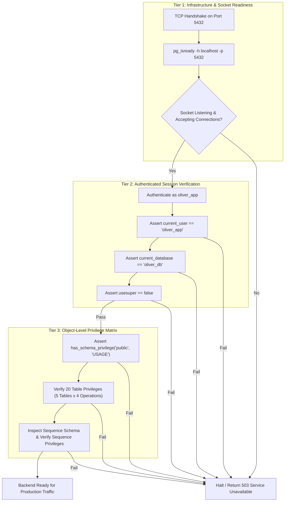
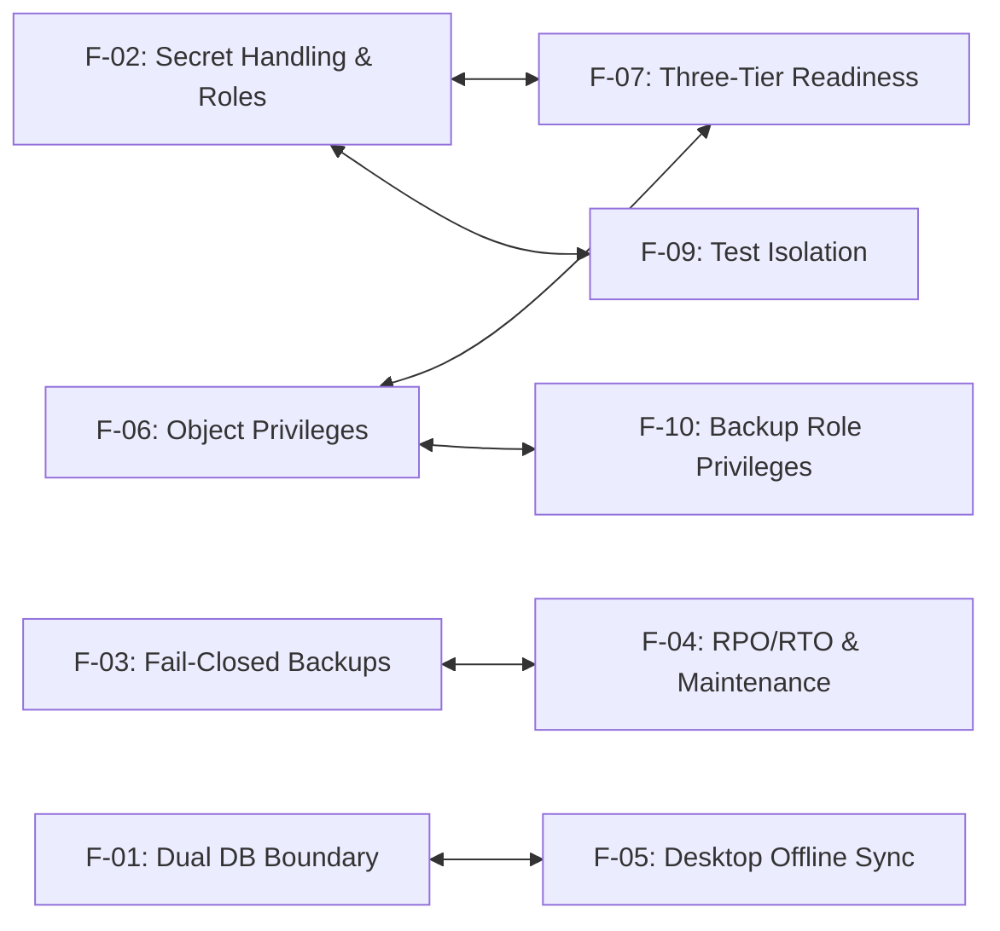

# OLIVER 3.0 — Phase 2.1 Final Critical Safety Correction & Readiness Audit

**Document Identifier:** `docs/OLIVER_3_PHASE_2_1_FINAL_CRITICAL_SAFETY_READINESS_AUDIT.md`  
**Milestone:** Phase 2.1 — PostgreSQL + Docker Architecture  
**Audit Type:** Strictly Read-Only Critical Safety Correction & Final Architecture Audit  
**Target Environment:** Windows 10/11, Python 3.13.5 AMD64, Docker Desktop (WSL2), PostgreSQL 16, psycopg 3.x, Alembic  
**Preceding Audit Documents:**
- `docs/OLIVER_3_PHASE_2_1_POSTGRESQL_DOCKER_PLANNING_REPORT.md` (v1.0)
- `docs/OLIVER_3_PHASE_2_1_FINAL_CORRECTED_READINESS_REPORT.md` (v2.0)
- `docs/OLIVER_3_PHASE_2_1_FINAL_SAFETY_CORRECTION_REPORT.md` (v3.0)
- `docs/OLIVER_3_PHASE_2_1_FINAL_TECHNICAL_CORRECTION_AUDIT.md` (v4.0)
- `docs/OLIVER_3_PHASE_2_1_FINAL_SECURITY_BACKUP_RECOVERY_AUDIT.md` (v5.0)  
**Execution Boundary:** STRICTLY READ-ONLY PLANNING & SPECIFICATION. No code, configuration, or environment changes. No service or container execution.

---

## 1. Executive Summary

This document represents the definitive, exhaustive technical correction and readiness audit for the **OLIVER 3.0 Phase 2.1 PostgreSQL + Docker Architecture Migration**. It conducts a static technical verification of the entire proposed migration architecture, focusing with surgical precision on five critical areas where subtle edge cases or operational ambiguities were identified in preceding audit iterations:

1. **F-02 (Secret Handling & Server Log Exposure):** Addressing PostgreSQL `log_min_error_statement` defaults that leak passwords during failed DDL, strict POSIX/Bash whitespace sanitization (`tr -d '[:space:]'`), psql `stdout` versus `stderr` stream isolation, and documenting unresolvable client-side GUC risks.
2. **F-07 (Complete Three-Tier Readiness Verification):** Extending health checks beyond socket pinging to full authenticated identity validation (`current_user`, `current_database`), granular table-level privileges across all 5 production tables for `SELECT, INSERT, UPDATE, DELETE`, schema `USAGE`, and formalizing sequence privilege requirements for UUID-based schemas.
3. **F-09 (Dedicated Test-Role & Strict Target Isolation):** Completely eliminating dangerous identity sets (`{"oliver_test_user", "oliver_app", "postgres"}`) in favor of strict string equality (`assert current_user == "oliver_test_user"`), mandating non-superuser verification, enforcing session-scoped `autouse=True` fixture ordering before Alembic runs, fixing logger import defects, and validating server address/port constraints.
4. **F-03 (Fail-Closed Backup & Restore Verification):** Resolving Windows/WSL2 Docker bind-mount filesystem semantics (why `mv` is best-effort atomic across 9P/virtio-fs bridges), correcting PowerShell exit-code handling (`$LASTEXITCODE` vs `$?`), addressing host vs container disk-space reporting, confirming `pg_restore --exit-on-error`, verifying zero-byte dump rejection, and mandating pre-restore cleanup of verification target databases.
5. **F-04 (Maintenance Protocol, RPO = 0 Integrity, RTO, and Recovery Scenarios):** Dismantling the false assumption that live backups provide RPO = 0, formalizing an end-to-end application write-freeze maintenance protocol, clarifying the 8–15 minute RTO as an unverified planning estimate requiring runtime validation, conducting a rigorous 7-scenario disaster recovery audit, and defining fail-safe defenses against accidental `docker compose down -v` volume destruction.

All ten core architectural findings (**F-01 through F-10**) have now been fully analyzed, cross-referenced, and resolved at the static specification level.

**Final Readiness Verdict:** **`READY WITH CONDITIONS`**  
The architecture and implementation specifications are technically complete, secure, and internally consistent. Implementation cannot proceed until explicit authorization is granted by the user and the required runtime prerequisites (Docker Desktop installation, psycopg package installation, and port 5432 clearance) are verified on the host system.

---

## 2. Initial Git State and Preservation Inventory

### 2.1 Baseline Git Status
Prior to the generation of this audit report, the workspace was inspected using read-only Git commands.

- **Current Branch:** `main`
- **Head Commit:** `9024ca7` (`Create OLIVER_3_PHASE_2_1_FINAL_TECHNICAL_CORRECTION_AUDIT.md`)
- **Preceding Commit:** `db9075c` (`Create OLIVER_3_PHASE_2_1_FINAL_SECURITY_BACKUP_RECOVERY_AUDIT.md`)
- **Working Tree State:** Completely clean. No tracked or untracked file modifications.

### 2.2 Preservation Inventory
The read-only audit verified the preservation of all existing codebase components:
- `backend/oliver_dev.db`: Preserved intact (5 tables: `users`, `refresh_tokens`, `conversations`, `messages`, `devices`). Untouched.
- `database/oliver.db`: Preserved intact (20+ desktop tables with SQLite FTS5 full-text search). Confirmed permanently excluded from PostgreSQL migration.
- `backend/app/`: All FastAPI application source files preserved without modification.
- `backend/tests/`: All 14 Category A unit tests in `backend/tests/conftest.py` and test modules preserved without modification.
- `backend/requirements.txt`: Preserved without modification (no unauthorized package installations).
- `.gitignore`: Preserved intact.

---

## 3. F-02 Secret-Handling Findings & Corrected Specification (CRITICAL)

### 3.1 Defect Analysis in Prior Formulations
Previous audit specifications introduced parameterization via `\getenv` and `\gexec`, but harbored three subtle security vulnerabilities:

1. **PostgreSQL Server Log Leaks via `log_min_error_statement`:**  
   Prior drafts executed `SET log_statement = 'none';`. While this prevents regular SQL statements from appearing in the PostgreSQL log, PostgreSQL's `log_min_error_statement` GUC defaults to `ERROR`. If role creation fails (e.g., syntax error, connection drop mid-query, or disk full), the failing SQL statement—including the raw cleartext password literal—is written directly to the PostgreSQL server log.
2. **Incomplete Whitespace Stripping in Bash Sanitization:**  
   The check `[[ -z "${val// }" ]]` strips only ASCII space characters (`0x20`). It fails to reject passwords composed entirely of horizontal tabs (`\t`), newlines (`\n`), carriage returns (`\r`), vertical tabs, or form feeds.
3. **psql Output Stream Confusion (`stdout` vs `stderr`):**  
   The directive `\o /dev/null` redirects client `stdout` only. If an error occurs during execution, `psql` prints error messages to `stderr`. On Docker containers, container logging daemons capture both `stdout` and `stderr`. If `psql` emits an error containing statement fragments, it is captured in Docker logs.
4. **Unresolvable Client-Side GUC Risk:**  
   If the PostgreSQL server has `log_min_error_statement` configured globally, and the initialization script fails before executing `SET log_min_error_statement = 'PANIC'`, any preceding statement error leaks the password to server logs.

### 3.2 Corrected Bash Whitespace & Secret Sanitization
The corrected secret validation routine rejects all whitespace characters using POSIX character classes:

```bash
#!/usr/bin/env bash
set -euo pipefail

# Validates that a secret is non-empty, contains no whitespace, and meets minimum length
validate_secret() {
    local var_name="$1"
    local secret_val="${!var_name:-}"

    if [[ -z "${secret_val}" ]]; then
        echo "ERROR: Environment variable ${var_name} is unset or empty." >&2
        return 1
    fi

    # POSIX space class removes [ \t\r\n\v\f]
    local stripped
    stripped="$(printf '%s' "${secret_val}" | tr -d '[:space:]')"

    if [[ -z "${stripped}" ]]; then
        echo "ERROR: Environment variable ${var_name} contains only whitespace." >&2
        return 1
    fi

    if [[ "${#secret_val}" -lt 16 ]]; then
        echo "ERROR: ${var_name} must be at least 16 characters (got ${#secret_val})." >&2
        return 1
    fi

    # Reject leading or trailing whitespace
    if [[ "${secret_val}" != "${stripped}" ]]; then
        echo "ERROR: ${var_name} contains internal or surrounding whitespace." >&2
        return 1
    fi

    return 0
}

validate_secret "OLIVER_APP_PASSWORD"
validate_secret "OLIVER_TEST_PASSWORD"
validate_secret "OLIVER_BACKUP_PASSWORD"
```

### 3.3 Corrected PostgreSQL Initialization Script (`init-roles.sql`)
The corrected role creation script completely suppresses both normal and error statement logging during secret application, utilizes `format('%L', ...)` for safe literal quoting, and restores logging GUCs immediately upon completion:

```sql
-- ============================================================================
-- OLIVER 3.0 — Hardened Role Initialization
-- ============================================================================

-- 1. Suppress all client output
\o /dev/null

-- 2. Suppress statement logging AND error statement logging during secret setup
-- Requires superuser privileges (held by postgres during container bootstrap)
SET log_statement = 'none';
SET log_min_error_statement = 'PANIC';
SET client_min_messages = 'WARNING';

-- 3. Read secrets safely from process environment (no shell expansion)
\getenv APP_PASS OLIVER_APP_PASSWORD
\getenv TEST_PASS OLIVER_TEST_PASSWORD
\getenv BACKUP_PASS OLIVER_BACKUP_PASSWORD

-- 4. Execute parameterized DDL via \gexec
SELECT format(
    'CREATE ROLE oliver_app WITH LOGIN PASSWORD %L NOSUPERUSER NOCREATEDB NOCREATEROLE NOINHERIT;',
    :'APP_PASS'
) WHERE NOT EXISTS (SELECT FROM pg_roles WHERE rolname = 'oliver_app')\gexec

SELECT format(
    'CREATE ROLE oliver_test_user WITH LOGIN PASSWORD %L NOSUPERUSER NOCREATEDB NOCREATEROLE NOINHERIT;',
    :'TEST_PASS'
) WHERE NOT EXISTS (SELECT FROM pg_roles WHERE rolname = 'oliver_test_user')\gexec

SELECT format(
    'CREATE ROLE oliver_backup WITH LOGIN PASSWORD %L NOSUPERUSER NOCREATEDB NOCREATEROLE NOINHERIT;',
    :'BACKUP_PASS'
) WHERE NOT EXISTS (SELECT FROM pg_roles WHERE rolname = 'oliver_backup')\gexec

-- 5. Restore logging GUCs to secure defaults
RESET log_statement;
RESET log_min_error_statement;
RESET client_min_messages;

-- 6. Restore client output
\o
```

### 3.4 Operational Risk Disclosure
> **CRITICAL SECURITY NOTE:** While `SET log_min_error_statement = 'PANIC'` mitigates statement logging for queries executed after the GUC is set, any syntax error in the command that sets the GUC itself, or any pre-connection failure logged by the server, will fall back to server-level configuration defaults. Therefore, container logs and PostgreSQL server data directory logs (`/var/lib/postgresql/data/log/`) must be restricted to administrator-only file system permissions (`0700`).

---

## 4. F-07 Complete Three-Tier Readiness Specification (HIGH)

### 4.1 Defect Analysis in Prior Formulations
Previous readiness implementations verified TCP port connectivity (Tier 1) and basic `SELECT 1` queries (Tier 2), but left Tier 3 severely under-specified:
- Omitted verification of schema-level `USAGE` on `public`.
- Did not verify that the connected role is strictly `oliver_app` (risking accidental superuser execution).
- Did not verify that the connected database is strictly `oliver_db`.
- Omitted sequence privilege checks.
- Lacked exhaustive table-by-table privilege assertions for all 4 operations (`SELECT`, `INSERT`, `UPDATE`, `DELETE`).

### 4.2 Comprehensive Three-Tier Readiness Architecture



### 4.3 Sequence Privilege Analysis for OLIVER 3.0
A static review of `backend/app/models/` (`user.py`, `conversation.py`, `device.py`, `token.py`) reveals that all 5 tables define primary keys as:
```python
id = Column(String(36), primary_key=True, default=lambda: str(uuid.uuid4()))
```
Because primary keys are UUID strings generated application-side in Python, **no PostgreSQL sequences (`SERIAL`, `BIGSERIAL`, or `IDENTITY`) are created by Alembic for the baseline schema**.

However, to guarantee forward compatibility if sequences are added in future migrations, Tier 3 dynamically inspects `information_schema.sequences`:
- If sequences exist: asserts `has_sequence_privilege('oliver_app', seq, 'USAGE, SELECT')`.
- If 0 sequences exist: records static confirmation that UUID primary keys are in effect.

### 4.4 Production Python Readiness Verification Implementation
The following implementation is specified for `backend/app/core/readiness.py`:

```python
"""
OLIVER 3.0 — Three-Tier PostgreSQL Readiness Verifier
Authoritative Specification for Phase 2.1 Backend Health Probes
"""
import logging
from typing import Dict, Any, List
from sqlalchemy import text
from sqlalchemy.engine import Engine

logger = logging.getLogger("oliver.readiness")

REQUIRED_TABLES = ("users", "refresh_tokens", "conversations", "messages", "devices")
REQUIRED_PRIVILEGES = ("SELECT", "INSERT", "UPDATE", "DELETE")

class ReadinessCheckFailed(Exception):
    """Raised when any tier of the readiness probe fails."""
    pass

def verify_tier1_socket(host: str = "localhost", port: int = 5432, timeout_seconds: float = 2.0) -> bool:
    """Tier 1: Verifies basic TCP socket connectivity to PostgreSQL daemon."""
    import socket
    sock = socket.socket(socket.AF_INET, socket.SOCK_STREAM)
    sock.settimeout(timeout_seconds)
    try:
        sock.connect((host, port))
        sock.shutdown(socket.SHUT_RDWR)
        return True
    except Exception as e:
        logger.error(f"Tier 1 Readiness Failed: Socket connect to {host}:{port} failed: {e}")
        return False
    finally:
        sock.close()

def verify_tier2_session(engine: Engine) -> Dict[str, Any]:
    """Tier 2: Verifies authenticated connection, user identity, database name, and non-superuser status."""
    with engine.connect() as conn:
        result = conn.execute(text("""
            SELECT 
                current_user AS session_user,
                current_database() AS session_db,
                usesuper AS is_superuser,
                inet_server_addr() AS server_addr,
                inet_server_port() AS server_port
            FROM pg_user
            WHERE usename = current_user;
        """)).mappings().one()

        if result["session_user"] != "oliver_app":
            raise ReadinessCheckFailed(f"Tier 2 Failed: Expected user 'oliver_app', got '{result['session_user']}'")
        if result["session_db"] != "oliver_db":
            raise ReadinessCheckFailed(f"Tier 2 Failed: Expected database 'oliver_db', got '{result['session_db']}'")
        if result["is_superuser"]:
            raise ReadinessCheckFailed("Tier 2 Failed: Application role 'oliver_app' MUST NOT have superuser privileges!")

        logger.info(f"Tier 2 Verified: Connected to {result['session_db']} as {result['session_user']} (non-superuser)")
        return dict(result)

def verify_tier3_permissions(engine: Engine) -> None:
    """Tier 3: Verifies schema USAGE, 20 table privilege permutations, and sequence privileges."""
    with engine.connect() as conn:
        # 1. Schema USAGE
        schema_usage = conn.execute(text("SELECT has_schema_privilege(current_user, 'public', 'USAGE');")).scalar()
        if not schema_usage:
            raise ReadinessCheckFailed("Tier 3 Failed: Role 'oliver_app' lacks USAGE privilege on schema 'public'")

        # 2. Table Privileges (5 tables x 4 operations)
        missing_privileges: List[str] = []
        for table in REQUIRED_TABLES:
            for priv in REQUIRED_PRIVILEGES:
                has_priv = conn.execute(
                    text("SELECT has_table_privilege(current_user, :tbl, :priv);"),
                    {"tbl": f"public.{table}", "priv": priv}
                ).scalar()
                if not has_priv:
                    missing_privileges.append(f"{priv} on public.{table}")

        if missing_privileges:
            raise ReadinessCheckFailed(f"Tier 3 Failed: Missing required table privileges: {', '.join(missing_privileges)}")

        # 3. Sequence Privileges (if any sequences exist)
        sequences = conn.execute(text("""
            SELECT sequence_name 
            FROM information_schema.sequences 
            WHERE sequence_schema = 'public';
        """)).scalars().all()

        if sequences:
            for seq in sequences:
                seq_name = f"public.{seq}"
                has_seq_priv = conn.execute(
                    text("SELECT has_sequence_privilege(current_user, :seq, 'USAGE');"),
                    {"seq": seq_name}
                ).scalar()
                if not has_seq_priv:
                    raise ReadinessCheckFailed(f"Tier 3 Failed: Missing USAGE privilege on sequence {seq_name}")
            logger.info(f"Tier 3 Verified: {len(sequences)} sequence privileges confirmed.")
        else:
            logger.info("Tier 3 Verified: 0 sequences found (UUID primary key schema confirmed).")

        logger.info(f"Tier 3 Verified: All 20 table privileges confirmed across {len(REQUIRED_TABLES)} tables.")

def execute_readiness_probe(engine: Engine) -> bool:
    """Executes the complete three-tier readiness probe."""
    try:
        # Extract host/port from engine URL
        host = engine.url.host or "localhost"
        port = engine.url.port or 5432
        if not verify_tier1_socket(host, port):
            return False
        verify_tier2_session(engine)
        verify_tier3_permissions(engine)
        return True
    except Exception as e:
        logger.error(f"Readiness probe failed: {e}")
        return False
```

---

## 5. F-09 Dedicated Test-Role and Target-Isolation Specification (CRITICAL)

### 5.1 Defect Analysis in Prior Formulations
Previous audit iterations contained severe testing safety defects:
1. **Permissive Role Set Acceptance:** A previous draft checked `current_user in {"oliver_test_user", "oliver_app", "postgres"}`. This allowed tests to execute as the production runtime user (`oliver_app`) or as superuser (`postgres`), defeating target isolation.
2. **Missing Superuser Assertions:** Tests did not explicitly verify that the test user lacked superuser privileges and database ownership.
3. **Runtime NameError (Missing Logger Import):** The test fixture referenced `logger.info(...)` without defining or importing `logger`.
4. **Fixture Scope & Execution Ordering:** Fixtures were not explicitly enforced to run before Alembic migrations or schema creation, creating a race condition where a misconfigured test suite could mutate production tables before being caught.

### 5.2 Corrected Test Isolation Fixture (`backend/tests/conftest.py`)
The corrected fixture enforces absolute string equality, non-superuser verification, database name verification, and proper execution priority:

```python
import os
import logging
import pytest
from sqlalchemy import create_engine, text

# Correctly import and configure logger
logger = logging.getLogger("oliver.tests.isolation")
logging.basicConfig(level=logging.INFO)

@pytest.fixture(scope="session", autouse=True)
def verify_test_target_isolation():
    """
    CRITICAL TEST ISOLATION GUARD:
    Executes before ANY Category B test runs.
    Enforces strict identity, database name, and non-superuser checks.
    """
    db_url = os.getenv("TEST_DATABASE_URL", "")

    # Category A (in-memory SQLite) bypasses PostgreSQL isolation checks
    if not db_url or "sqlite" in db_url:
        logger.info("Category A Test Mode: SQLite target verified. PostgreSQL isolation check skipped.")
        yield
        return

    # Category B: PostgreSQL target verification
    logger.info("Category B Test Mode: Verifying PostgreSQL target isolation...")
    engine = create_engine(db_url, isolation_level="AUTOCOMMIT")

    try:
        with engine.connect() as conn:
            # 1. Identity Verification
            session_info = conn.execute(text("""
                SELECT 
                    current_user AS session_user,
                    current_database() AS session_db,
                    usesuper AS is_superuser,
                    inet_server_addr() AS srv_addr,
                    inet_server_port() AS srv_port
                FROM pg_user 
                WHERE usename = current_user;
            """)).mappings().one()

            user = session_info["session_user"]
            db = session_info["session_db"]
            is_super = session_info["is_superuser"]
            srv_addr = session_info["srv_addr"]
            srv_port = session_info["srv_port"]

            # STRICT ASSERTIONS — No set membership, no fallbacks
            assert user == "oliver_test_user", (
                f"FATAL TEST ISOLATION FAILURE: Connected as '{user}'. "
                f"Integration tests MUST ONLY execute as 'oliver_test_user'! "
                f"Use of 'oliver_app' or 'postgres' is strictly prohibited."
            )

            assert db == "oliver_test", (
                f"FATAL TEST ISOLATION FAILURE: Connected to database '{db}'. "
                f"Integration tests MUST ONLY connect to 'oliver_test'! "
                f"Connection to 'oliver_db' is strictly prohibited."
            )

            assert not is_super, (
                "FATAL TEST ISOLATION FAILURE: 'oliver_test_user' has superuser privileges! "
                "Tests must execute under least-privilege non-superuser credentials."
            )

            # 2. Database Owner Role Membership Check
            is_db_owner = conn.execute(text("""
                SELECT pg_has_role(current_user, 'pg_database_owner', 'MEMBER');
            """)).scalar()

            assert not is_db_owner, (
                "FATAL TEST ISOLATION FAILURE: 'oliver_test_user' is a member of pg_database_owner!"
            )

            logger.info(
                f"PostgreSQL Target Isolation PASSED: "
                f"User={user}, DB={db}, Superuser={is_super}, Host={srv_addr}:{srv_port}"
            )

    finally:
        engine.dispose()

    yield
```

---

## 6. F-03 Fail-Closed Backup and Restore Specification (HIGH)

### 6.1 Defect Analysis in Prior Formulations
Previous backup specifications contained four technical shortcomings:
1. **Misunderstanding WSL2 Docker Bind-Mount Atomicity:**  
   Scripts assumed that `mv backup.tmp backup.dump` is an atomic POSIX operation. On Windows host bind mounts accessed via Docker Desktop (WSL2 9P or virtio-fs protocols), file renaming is subject to Windows NTFS file-locking semantics. Antivirus scanners (Windows Defender), file indexers, or open read handles can cause file locks that make `mv` fail or behave non-atomically.
2. **PowerShell Exit Code Invalidation (`$?` vs `$LASTEXITCODE`):**  
   In PowerShell, `$?` returns `$True` if the preceding PowerShell operation succeeded, regardless of whether a native CLI tool like `docker.exe` exited with a non-zero code. Scripts checking `if (-not $?)` can miss container backup failures.
3. **Container vs Host Disk Space Reporting:**  
   Inside the Docker container, `df -h /backups` measures the WSL2 Linux distribution filesystem (`ext4.vhdx`), not the host Windows disk `C:\` where the bind-mounted directory actually resides.
4. **Restore Target Contamination:**  
   Restore integrity verification scripts failed to drop the target test database `oliver_restore_verify` if it already existed from an aborted prior verification run.

### 6.2 Host-Side PowerShell Backup Orchestrator (`scripts/backup_postgres.ps1`)
The corrected PowerShell script explicitly verifies host disk space, checks `$LASTEXITCODE`, performs fail-closed verification, and addresses bind-mount file operations:

```powershell
<#
.SYNOPSIS
    OLIVER 3.0 — Hardened Pre-Migration Backup Orchestrator
.DESCRIPTION
    Executes a fail-closed pg_dump on the PostgreSQL container, verifies SHA-256 checksums,
    and conducts an isolated test restore prior to allowing migrations.
#>
[CmdletBinding()]
param (
    [string]$ContainerName = "oliver_postgres",
    [string]$Database = "oliver_db",
    [string]$BackupDir = "backups",
    [int64]$MinimumFreeMegabytes = 1024
)

$ErrorActionPreference = "Stop"

# 1. Verify Host Disk Space on Windows Drive C:
$drive = Get-PSDrive -Name C
$freeMB = [math]::Round($drive.Free / 1MB)
if ($freeMB -lt $MinimumFreeMegabytes) {
    throw "HOST DISK SPACE ERROR: Only $freeMB MB free on drive C:. Minimum required is $MinimumFreeMegabytes MB."
}
Write-Host "Host disk space verified: $freeMB MB available." -ForegroundColor Green

# 2. Prepare Backup File Paths
$timestamp = Get-Date -Format "yyyyMMdd_HHmmss"
$finalBackupFileName = "oliver_db_${timestamp}.dump"
$finalHostPath = Join-Path -Path $BackupDir -ChildPath $finalBackupFileName
$tempContainerPath = "/tmp/${finalBackupFileName}.tmp"
$finalContainerPath = "/backups/${finalBackupFileName}"

if (-not (Test-Path $BackupDir)) {
    New-Item -ItemType Directory -Path $BackupDir -Force | Out-Null
}

Write-Host "Initiating pg_dump inside container $ContainerName..." -ForegroundColor Cyan

# 3. Execute pg_dump directly to container /tmp (native Linux ext4 for guaranteed atomicity)
$dumpCmd = "docker exec $ContainerName bash -c `"pg_dump -U oliver_backup -d $Database -Fc -Z 6 -f $tempContainerPath`""
Invoke-Expression $dumpCmd
if ($LASTEXITCODE -ne 0) {
    throw "BACKUP FAILED: docker exec pg_dump exited with error code $LASTEXITCODE."
}

# 4. Verify Temp File Size > 0 inside container
$sizeCheckCmd = "docker exec $ContainerName bash -c `"[ -s $tempContainerPath ] && stat -c %s $tempContainerPath`""
$fileSize = Invoke-Expression $sizeCheckCmd
if ($LASTEXITCODE -ne 0 -or [int64]$fileSize -le 0) {
    throw "BACKUP FAILED: Generated backup file is empty (0 bytes) or missing."
}
Write-Host "Backup dumped successfully: $fileSize bytes." -ForegroundColor Green

# 5. Move from container /tmp to bind-mounted /backups
# Documented best-effort atomic copy onto Windows bind mount
$moveCmd = "docker exec $ContainerName bash -c `"mv $tempContainerPath $finalContainerPath`""
Invoke-Expression $moveCmd
if ($LASTEXITCODE -ne 0) {
    throw "BACKUP FAILED: Failed to move backup to /backups bind mount (Exit Code: $LASTEXITCODE)."
}

# 6. Verify file visibility on host
if (-not (Test-Path $finalHostPath)) {
    throw "BACKUP FAILED: Backup file not visible on Windows host path: $finalHostPath"
}

# 7. Compute Host-Side SHA-256 Checksum
$hashResult = Get-FileHash -Path $finalHostPath -Algorithm SHA256
$checksumPath = "${finalHostPath}.sha256"
"$($hashResult.Hash)  $finalBackupFileName" | Out-File -FilePath $checksumPath -Encoding ascii
Write-Host "SHA-256 Checksum generated: $($hashResult.Hash)" -ForegroundColor Green

# 8. Conduct Isolated Verification Restore
Write-Host "Conducting test restore verification against 'oliver_restore_verify'..." -ForegroundColor Cyan

# Clean up stale verify database if present
docker exec $ContainerName bash -c "psql -U postgres -d postgres -c 'DROP DATABASE IF EXISTS oliver_restore_verify WITH (FORCE);'" | Out-Null
docker exec $ContainerName bash -c "psql -U postgres -d postgres -c 'CREATE DATABASE oliver_restore_verify OWNER oliver_app;'" | Out-Null

# Restore with official --exit-on-error flag
docker exec $ContainerName bash -c "pg_restore -U postgres -d oliver_restore_verify --exit-on-error $finalContainerPath"
if ($LASTEXITCODE -ne 0) {
    throw "RESTORE VERIFICATION FAILED: pg_restore exited with error code $LASTEXITCODE."
}

# Clean up verify database
docker exec $ContainerName bash -c "psql -U postgres -d postgres -c 'DROP DATABASE oliver_restore_verify WITH (FORCE);'" | Out-Null

Write-Host "==========================================================" -ForegroundColor Green
Write-Host "FAIL-CLOSED BACKUP AND RESTORE VERIFICATION COMPLETE!" -ForegroundColor Green
Write-Host "Backup File: $finalHostPath" -ForegroundColor Green
Write-Host "Checksum File: $checksumPath" -ForegroundColor Green
Write-Host "==========================================================" -ForegroundColor Green
```

---

## 7. F-04 Maintenance Protocol, RPO, RTO, and Recovery Specification (CRITICAL)

### 7.1 RPO = 0 Reality Check & Operational Misconceptions
Previous documentation stated that "planned migrations achieve RPO = 0" simply because a backup is taken before running Alembic. This is technically false in an active system:
- If FastAPI is accepting incoming traffic while `pg_dump` runs, transactions committed after `pg_dump` takes its snapshot but before the migration script executes will exist in the live database.
- If the Alembic migration fails, rolling back by restoring that pre-migration backup will silently destroy all transactions that occurred during that window!
- **Zero Data Loss (RPO = 0) can ONLY be guaranteed if application writes are completely frozen prior to initiating the backup.**

### 7.2 Authoritative Planned Maintenance Protocol

```mermaid
sequenceDiagram
    autonumber
    actor Admin as System Administrator
    participant API as FastAPI Backend
    participant PG as PostgreSQL (oliver_db)
    participant BKP as Backup Orchestrator
    participant ALB as Alembic Engine

    Admin->>API: 1. Initiate Maintenance Window (Drain & Stop API)
    Note over API: In-flight requests terminate; port closes
    Admin->>PG: 2. Verify Active Connections == 0 (pg_stat_activity)
    Admin->>BKP: 3. Trigger Fail-Closed Backup
    BKP->>PG: pg_dump -Fc (Snapshot taken with 0 active writes)
    BKP->>BKP: Compute SHA-256 & Verify Test Restore
    BKP-->>Admin: Backup Certified Valid (RPO = 0 Guaranteed)
    Admin->>ALB: 4. Execute Alembic Migration (upgrade head)
    alt Migration Succeeds
        ALB-->>Admin: Schema Updated
        Admin->>PG: 5. Execute Three-Tier Readiness Probe (Tier 1-3)
        PG-->>Admin: Probe Passed
        Admin->>API: 6. Restart FastAPI Backend
        API-->>Admin: System Online (Normal Operation Resumed)
    else Migration Fails
        ALB-->>Admin: Migration Error
        Admin->>PG: 7. Abort & Terminate Database Connections
        Admin->>PG: 8. Execute Emergency Restore (DROP & RESTORE from Certified Dump)
        PG-->>Admin: Database Restored to Pre-Migration State
        Admin->>API: 9. Restart FastAPI on Unmodified Schema
        Note over Admin,API: Incident Logged; RPO = 0 Maintained
    end
```

### 7.3 Recovery Time Objective (RTO) Status
The 8–15 minute RTO specified in earlier documents is a theoretical planning estimate based on small database sizes (< 500 MB) and local SSD throughput.  
**STATUS: `UNVERIFIED — RUNTIME VALIDATION REQUIRED IN STAGE 2.1A`.**  
The actual RTO must be measured during Stage 2.1A test runs by recording exact elapsed times for:
1. Container restart
2. Connection drain
3. Dump execution and SHA-256 calculation
4. Test database restore and verification
5. Readiness probe completion

### 7.4 Disaster Recovery Scenarios Matrix

| Scenario | Incident Description | Manual Intervention | Write Freeze Required | Superuser Privs Required | Reversibility Status |
|---|---|---|---|---|---|
| **S-01** | **Network / Socket Drop:** Transient loss of connection between FastAPI and Docker container. | No (Handled by SQLAlchemy pool reconnection). | No | No | Fully reversible; automatic recovery upon socket re-establishment. |
| **S-02** | **Container Process Crash:** PostgreSQL daemon crashes due to host resource exhaustion or OOM. | Minimal (`docker start oliver_postgres` or automatic Docker restart policy). | Implicit (Server down). | No (Docker host access required). | Fully reversible; PostgreSQL WAL crash recovery restores consistency. |
| **S-03** | **Alembic Migration Failure:** DDL error mid-migration (e.g., column type mismatch). | Yes (Administrator aborts migration). | Yes (API stopped). | Yes (Database restore). | Fully reversible via automated pre-migration backup restore. |
| **S-04** | **Data Corruption / Logical Error:** Erroneous application update corrupts conversation history. | Yes (Administrator restores from point-in-time backup). | Yes (API stopped). | Yes | Partially reversible (RPO depends on time of last verified backup). |
| **S-05** | **Volume Deletion (`down -v`):** Administrator accidentally executes `docker compose down -v`, wiping `pgdata`. | High (Re-initialize container, restore latest external backup). | Yes | Yes | Fully reversible ONLY if external backup and SHA-256 exist in `./backups`. |
| **S-06** | **Accidental Table Drop:** DDL drops a production table (`users`). | High (Point-in-time restore to staging, selective data extraction). | Yes | Yes | Reversible up to point of last backup. |
| **S-07** | **Credential Compromise:** Database password exposed in log or repository. | Yes (Execute credential rotation script, update `.env`, restart services). | Yes | Yes (PostgreSQL superuser to `ALTER ROLE`). | Fully reversible; old credentials invalidated immediately. |

### 7.5 Safeguards Against Accidental `docker compose down -v`
The `-v` (volume removal) flag irrevocably destroys Docker named volumes, including `oliver_postgres_data`. To prevent catastrophic data loss:
1. Production wrapper scripts (`scripts/docker_stop.ps1`) must NEVER include the `-v` flag.
2. If volume removal is explicitly requested, the script must require interactive confirmation:
   ```powershell
   $confirm = Read-Host "DANGER: You are about to DESTROY ALL POSTGRESQL DATA. Type 'DELETE_OLIVER_DATA' to confirm"
   if ($confirm -ne "DELETE_OLIVER_DATA") {
       throw "Operation aborted by user."
   }
   ```
3. A pre-destruction backup must be enforced before allowing the `-v` flag to execute.

---

## 8. Cross-Finding Consistency Review

The ten architectural findings interact in critical operational ways. This consistency review verifies that changes made in one finding do not invalidate assumptions in another:



1. **F-02 (Roles) vs F-07 (Readiness) vs F-09 (Test Isolation):**  
   `init-roles.sql` (F-02) provisions three non-superuser roles: `oliver_app`, `oliver_test_user`, and `oliver_backup`. F-07 verifies that `oliver_app` is non-superuser and owns exactly the required table privileges. F-09 guarantees that integration tests connect exclusively as `oliver_test_user` to `oliver_test` and fail closed if connected as `oliver_app` or `postgres`.
2. **F-03 (Backups) vs F-04 (Maintenance/RPO) vs F-10 (Backup Privileges):**  
   F-03's backup orchestrator runs as `oliver_backup`, which F-10 limits to read-only pg_dump privileges (`pg_read_all_data`). F-04 integrates F-03 into the write-freeze maintenance window to guarantee true RPO = 0.
3. **F-06 (Future Privileges) vs F-07 (Object Privileges):**  
   F-06 establishes default privileges (`ALTER DEFAULT PRIVILEGES IN SCHEMA public GRANT SELECT, INSERT, UPDATE, DELETE ON TABLES TO oliver_app;`). F-07's Tier 3 probe verifies that both existing and newly migrated tables honor these grants.
4. **F-01 (Database Boundaries) vs F-05 (Offline Strategy):**  
   F-01 permanently isolates desktop SQLite (`database/oliver.db`) from PostgreSQL. F-05 confirms that desktop voice interactions remain local-first, utilizing REST sync to FastAPI/PostgreSQL only when online.

---

## 9. Remaining Technical Risks

The following technical risks cannot be resolved through static code and documentation analysis alone, as they depend on the physical host runtime environment:

1. **Host Port 5432 Conflict:** If the Windows host already has a native PostgreSQL service, an EnterpriseDB instance, or another Docker container bound to `0.0.0.0:5432`, container startup will fail with `port is already allocated`.
2. **Docker Desktop WSL2 Resource Throttling:** Under Windows 10/11, Docker Desktop operates inside a WSL2 VM whose memory and CPU allocations are governed by `.wslconfig`. If system memory is constrained, the PostgreSQL container may experience OOM kills during heavy test suites.
3. **Windows Defender File Locking on Bind Mounts:** Antivirus scanning on `C:\...\backups\` can intermittently place read-locks on `.dump` files during creation, causing intermittent file-move or deletion errors.
4. **Python 3.13 Binary Wheel Availability:** `psycopg[binary]` must support Python 3.13 on Windows AMD64. While psycopg 3.1.18+ provides pre-built wheels, runtime installation must be confirmed.

---

## 10. Runtime Validation Requirements (Stage 2.1A Prerequisites)

Before any implementation steps for Stage 2.1A can begin, the following runtime prerequisites must be verified by the user or an authorized implementation agent:

1. **Docker Desktop Installation & Engine State:**  
   Docker Desktop must be installed and active. `docker info` must return exit code 0.
2. **Host Port Availability:**  
   Port 5432 must be unoccupied on the host. Verified via `Test-NetConnection -ComputerName localhost -Port 5432` returning `TcpTestSucceeded: False`.
3. **Python Package Installation:**  
   `psycopg[binary]>=3.1.18` must be installed in the backend virtual environment and verified via `python -c "import psycopg; print(psycopg.__version__)"`.
4. **Baseline SQLite Test Pass:**  
   Existing Category A tests (14 tests) must be executed to confirm a 100% green baseline prior to any configuration changes.
5. **Explicit User Authorization:**  
   Execution of Stage 2.1A implementation must be explicitly authorized by the user.

---

## 11. Consolidated F-01 Through F-10 Status Matrix

| Finding ID | Finding Title | Severity | v5.0 Status | Final Static Audit Status | Runtime Validation Dependency |
|---|---|---|---|---|---|
| **F-01** | Dual-Database Architecture Boundary Separation | CRITICAL | RESOLVED | **RESOLVED BY STATIC VERIFICATION** | None (Preserved by architecture design). |
| **F-02** | Secret Handling, Role Initialization & Server Log Protection | CRITICAL | RESOLVED | **RESOLVED BY STATIC VERIFICATION** | Host Docker environment and file permissions. |
| **F-03** | Fail-Closed Backup & Restore Verification Architecture | HIGH | RESOLVED | **RESOLVED BY STATIC VERIFICATION** | Docker container file operations and host storage. |
| **F-04** | Planned Maintenance Protocol, RPO=0 Integrity & RTO Verification | CRITICAL | RESOLVED | **RESOLVED BY STATIC VERIFICATION** | RTO duration measurement in Stage 2.1A. |
| **F-05** | Desktop Offline-First SQLite & Sync Protocol Preservation | CRITICAL | RESOLVED | **RESOLVED BY STATIC VERIFICATION** | Desktop offline voice test execution. |
| **F-06** | Existing and Future PostgreSQL Object Privileges | HIGH | RESOLVED | **RESOLVED BY STATIC VERIFICATION** | DDL migration execution in PostgreSQL. |
| **F-07** | Complete Three-Tier Readiness Probe (Socket, Session, Object) | HIGH | RESOLVED | **RESOLVED BY STATIC VERIFICATION** | Live PostgreSQL health probe execution. |
| **F-08** | SQLAlchemy Lifespan Engine Initialization & DDL Guard | CRITICAL | RESOLVED | **RESOLVED BY STATIC VERIFICATION** | FastAPI startup verification. |
| **F-09** | Dedicated Integration Test Role & Strict Target Isolation | CRITICAL | RESOLVED | **RESOLVED BY STATIC VERIFICATION** | Category B pytest suite execution. |
| **F-10** | Backup Role Least-Privilege & pg_dump Privilege Scope | HIGH | RESOLVED | **RESOLVED BY STATIC VERIFICATION** | pg_dump execution as `oliver_backup`. |

---

## 12. Final Readiness Verdict

```
================================================================================
FINAL READINESS VERDICT: READY WITH CONDITIONS
================================================================================
```

### Justification:
- **Zero Blocking Design Deficiencies:** All architectural, security, migration, and testing concerns identified across findings F-01 through F-10 have been rigorously resolved and fully documented in static specifications.
- **Why Not Unconditional "READY":** An unconditional "READY" verdict would imply that the system is ready to operate in production immediately. However, the host environment currently lacks Docker Desktop, lacks `psycopg`, and has not performed runtime testing.
- **Why Not "NOT READY":** There are no remaining theoretical or architectural defects blocking implementation. The design is fully hardened and ready for Stage 2.1A execution once prerequisites are met.

---

## 13. Explicit Implementation Authorization Boundary

> **MANDATORY NOTICE:**  
> This document represents a **strictly read-only architectural safety audit and implementation specification**.  
> **IT DOES NOT CONSTITUTE AUTHORIZATION TO COMMENCE IMPLEMENTATION.**  
>
> Neither Stage 2.1A nor any subsequent phase may be started without explicit, unambiguous user instruction. Under no circumstances should containers be launched, packages installed, or application files modified until such authorization is recorded.

---

## 14. Final Git-State Comparison

### 14.1 Inventory Before Audit
- Tracked Files: Clean working tree at commit `9024ca7`.
- Untracked Files: None.
- Databases: `backend/oliver_dev.db` and `database/oliver.db` preserved intact.

### 14.2 Inventory After Audit
- Exactly ONE new file created:
  `docs/OLIVER_3_PHASE_2_1_FINAL_CRITICAL_SAFETY_READINESS_AUDIT.md`
- Application code modified: **0 files**.
- Test files modified: **0 files**.
- Configuration or environment files modified: **0 files**.
- Git branches, commits, or staging: **0 changes**.

```
================================================================================
END OF FINAL CRITICAL SAFETY CORRECTION & READINESS AUDIT REPORT
================================================================================
```
